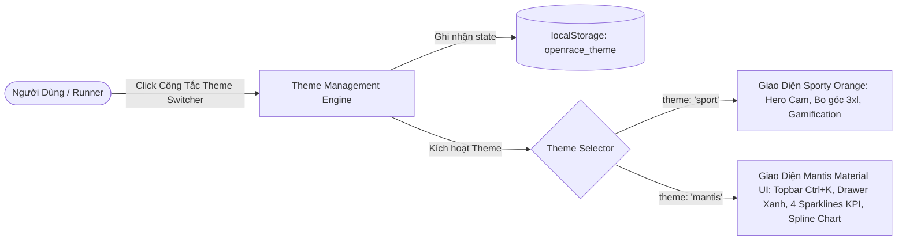
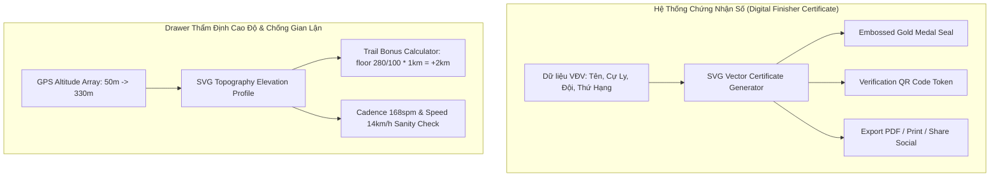
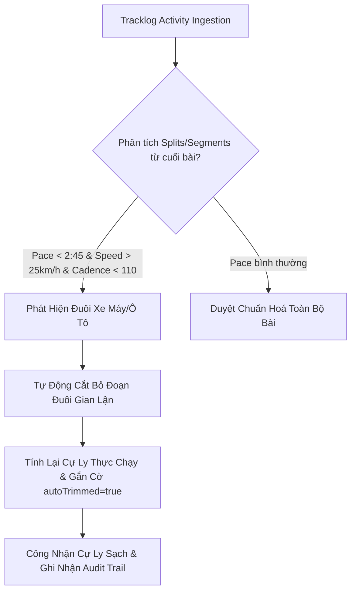
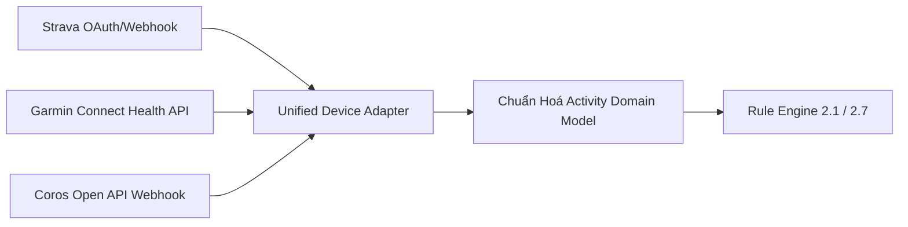
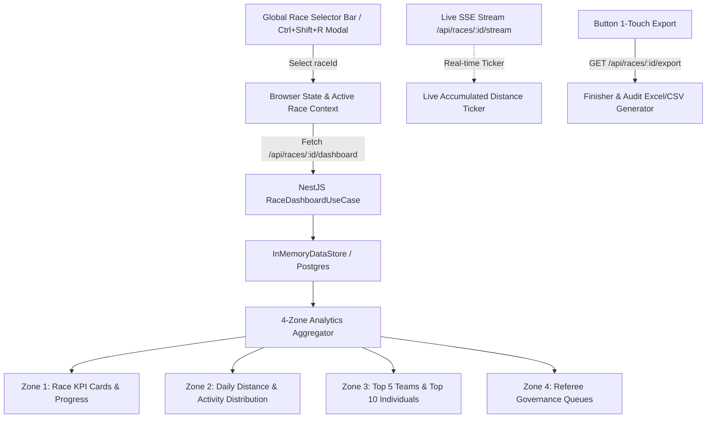
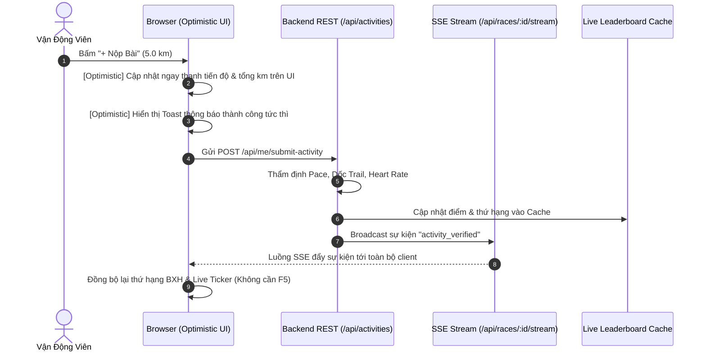
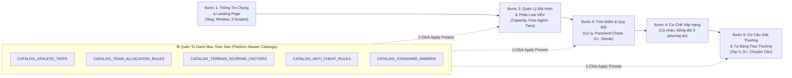
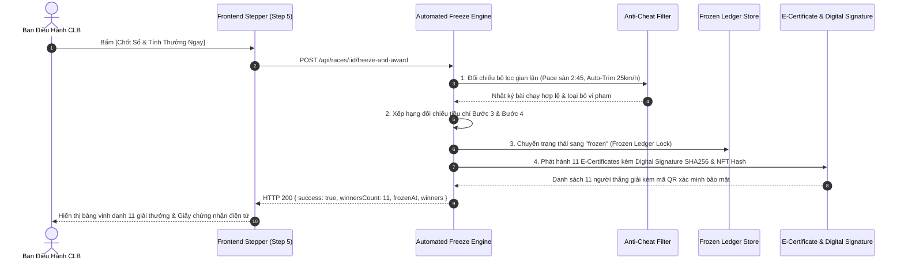

# SYSTEM ARCHITECTURE SPECIFICATION (V2.1 FULL PLATFORM)
## OpenRace SaaS Platform — Multi-Club Online Running Management, Social Athletics & Club ERP
**Version:** 2.1.0  
**Authority Reference:** `inputs/SRS2_1.md` (OR-SRS-SDS-2026-V2.1), `shared_context/PRD.md`  
**Stack Rule:** STRICT TYPESCRIPT (NestJS Hexagonal/Clean Architecture + Next.js 15 App Router + Supabase PostgreSQL 16 + Redis 7 + Jest) — NO PYTHON ALLOWED.  

---

### 1. Kiến Trúc Cặp 2 Màn Hình & Cây Điều Hướng V2.1 (Taxonomy)

Theo chuẩn đặc tả tại `inputs/SRS2_1.md` Mục 3 và Mục 4, hệ thống OpenRace SaaS v2.1 được chuẩn hóa thành 10 Cặp màn hình chức năng (20 màn hình lõi) bổ trợ lẫn nhau theo mô hình Master-Detail / List-Action:

```
========================================================================================
CÂY MENU ĐIỀU HƯỚNG TOÀN SÀN OPENRACE V2.1 (CHỈ DẪN URL ROUTING)
========================================================================================

[PHÂN HỆ NGƯỜI DÙNG & RUNNER]
├── [Cặp 1] Cá nhân & Đồng bộ Strava
│   ├── UI-01A: Dashboard Runner (Personal Hub) .......................... Path: /
│   └── UI-01B: Quản lý Kết nối & Nhật ký Strava Sync ................... Path: /me/strava-sync
├── [Cặp 2] Giải đấu & Đấu trường
│   ├── UI-02A: Khám phá & Danh sách Giải đấu ............................ Path: /races
│   └── UI-02B: Đấu trường Giải & Bảng xếp hạng Thời gian thực ........... Path: /r/{race_slug}
├── [Cặp 3] Nhật ký Hoạt động & Thẩm định
│   ├── UI-03A: Bảng tổng hợp Bài chạy Cá nhân ........................... Path: /activities
│   └── UI-03B: Chi tiết Thẩm định & Gửi Khiếu nại ....................... Path: /activities/{id}
├── [Cặp 4] Câu lạc bộ & Tiếp nhận lời mời
│   ├── UI-04A: Trang chủ Câu lạc bộ (Club Portal) ....................... Path: /c/{club_slug}
│   └── UI-04B: Cổng Tiếp nhận Lời mời & Onboarding Gia nhập ............. Path: /join/{invite_token}
├── [Cặp 5] Tài chính & Minh bạch Quỹ
│   ├── UI-05A: Sổ nợ & VietQR Nộp tiền Cá nhân .......................... Path: /r/{race_slug}/my-finance
│   └── UI-05B: Bảng Đối soát Quỹ Giải & Xác nhận Nộp tiền (Admin) ....... Path: /r/{race_slug}/finance/reconcile
├── [Cặp 7] Đội thi đấu (Không gian Đội)
│   ├── UI-07A: Danh bạ & Bảng phong độ Đội thi đấu ...................... Path: /r/{race_slug}/teams
│   └── UI-07B: Không gian Quản trị Đội của Đội trưởng .................. Path: /r/{race_slug}/teams/{id}/manage
├── [Cặp 8] Mạng xã hội Chạy bộ & Bạn bè
│   ├── UI-08A: Bảng tin Hoạt động Cộng đồng (Social Feed) ............... Path: /community/feed
│   └── UI-08B: Mạng lưới Bạn bè & Hồ sơ Vận động viên ................... Path: /community/friends
├── [Cặp 9] Tán gẫu, PacerBot AI & Banter
│   ├── UI-09A: Phòng Chat Thời gian thực (Kênh CLB & Đội) ............... Path: /chat
│   └── UI-09B: Trung tâm Điều khiển AI PacerBot & Banter Engine ........ Path: /clubs/{slug}/banter-settings

[PHÂN HỆ BAN QUẢN TRỊ CLB & SUPER ADMIN]
├── [Cặp 6] Điều hành Thể lệ Giải đấu
│   ├── UI-06A: Danh sách Quản trị Giải đấu CLB .......................... Path: /clubs/{slug}/races-manage
│   └── UI-06B: Wizard 7 bước Thiết lập Thể lệ & Dry-run ................. Path: /clubs/{slug}/races/wizard
└── [Cặp 10] Điều hành Toàn diện Câu lạc bộ (Club ERP)
    ├── UI-10A: Trung tâm Điều hành CLB (Tổng quan & Quản lý Thành viên) . Path: /clubs/{slug}/manage
    └── UI-10B: Quản trị Kỷ luật, Lịch Sự kiện & Kho Tri thức ........... Path: /clubs/{slug}/governance
========================================================================================
```

---

### 2. Thiết Kế Cơ Sở Dữ Liệu PostgreSQL 16 (Supabase)

Hệ thống quản lý dữ liệu đa người thuê (Multi-tenancy) cô lập theo `club_id` và áp dụng bảo mật hàng RLS:

#### Danh mục 18+ Bảng thực thể:
1. `users`: Tài khoản toàn cục, email, avatar, oauth_tokens, preferences.
2. `clubs`: Thực thể CLB độc lập, slug, logo, cover_url, bio, hotline.
3. `club_payment_accounts`: Cấu hình tài khoản ngân hàng thụ hưởng VietQR (Bank BIN, STK, Tên chủ TK).
4. `club_members`: Thành viên CLB, vai trò (`admin`, `captain`, `member`), trạng thái (`active`, `suspended`).
5. `races`: Giải đấu, slug, phạm vi (`internal`, `community`, `designated_whitelist`), trạng thái vòng đời.
6. `race_rules`: Tham số Rule Set dạng JSONB bất biến theo số hiệu phiên bản `version`.
7. `race_whitelists`: Danh sách email vận động viên được cấp quyền tham gia giải chỉ định.
8. `teams`: Đội thi đấu trong giải, tên đội, cờ hiệu avatar đội, đội trưởng `leader_id`, slogan.
9. `race_participants`: Ghi danh tham gia giải, gán đội `team_id`, đồng thuận kép (`consent_strava`, `consent_rules`).
10. `activities`: Bài chạy thô từ Strava (immutable), polyline, khoảng thời gian `start_at` -> `end_at`.
11. `activity_logs`: Bản ghi thẩm định của Activity trong 1 Race cụ thể, lưu mã lỗi `reject_code`, cự ly công nhận `final_distance_km`.
12. `appeals`: Đơn khiếu nại bài chạy lỗi, lý do, ảnh minh chứng, trạng thái (`OPEN`, `APPROVED`, `REJECTED`).
13. `ledger_entries`: Sổ cái tài chính bất biến, tiền quỹ theo bậc thứ hạng, tiền phạt tuần, thanh toán.
14. `penalty_waivers`: Quyết định miễn trừ phạt tuần do Admin phê duyệt kèm lý do.
15. `strava_sync_logs`: Nhật ký nhận gói tin webhook thô từ Strava, phục vụ tra cứu kỹ thuật.
16. `friendships`: Đồ thị bạn bè 2 chiều (`requester_id`, `addressee_id`, `status: PENDING | ACCEPTED`).
17. `kudos`: Lượt thả tim/khen ngợi hoạt động chạy bộ cộng đồng.
18. `comments`: Bình luận thảo luận dưới bài chạy cộng đồng.
19. `chat_messages`: Tin nhắn trong các phòng chat (CLB, Đội, Ban chủ nhiệm, bot messages).
20. `club_events`: Sự kiện sinh hoạt & buổi chạy Offline của CLB, lịch tập trung, file GPX, RSVP.
21. `club_polls` & `poll_votes`: Biểu quyết nội bộ CLB và phiếu bầu của thành viên.

---

### 3. Kiến Trúc Backend NestJS (Clean / Modular Architecture)

```
workspace/backend/src/
├── application/
│   ├── dtos/                    # DTOs with class-validator
│   └── use-cases/               # Use cases / Application services
│       ├── webhook-ingestion.use-case.ts
│       ├── rule-engine.use-case.ts
│       ├── scoring-leaderboard.use-case.ts
│       ├── cycle-penalty.use-case.ts
│       ├── finance-vietqr.use-case.ts
│       ├── team-management.use-case.ts
│       ├── community-social.use-case.ts
│       ├── chat-banter.use-case.ts
│       ├── club-governance.use-case.ts
│       └── admin-management.use-case.ts
├── domain/                      # Domain logic & pure calculations
│   ├── rule-engine/             # 6-step validation pipeline & 2:45 pace floor
│   ├── scoring/                 # 50/50 distance + diligence scoring
│   ├── cycle-penalty/           # Weekly cycle, 6h grace period, proration
│   └── finance/                 # VietQR generation (<= 25 chars) & ledger
└── infrastructure/
    ├── controllers/             # RESTful API controllers
    ├── gateways/                # WebSockets & SSE live stream gateways
    ├── repositories/            # Data stores & PostgreSQL / Supabase client
    └── workers/                 # Background queue processors (BullMQ)
```

---

### 4. Kiến Trúc Frontend Next.js 15 (App Router Structure)

```
workspace/frontend/src/app/
├── (auth)/
│   └── login/page.tsx           # Authentication with Google/Apple & Strava OAuth
├── (runner)/
│   ├── page.tsx                 # [UI-01A] Dashboard Runner Hub
│   ├── me/
│   │   └── strava-sync/page.tsx # [UI-01B] Strava Sync Logs & Connection Control
│   ├── races/
│   │   ├── page.tsx             # [UI-02A] Explore Races Directory
│   │   └── [slug]/
│   │       ├── page.tsx         # [UI-02B] Race Arena & Live SSE Leaderboard
│   │       ├── my-finance/page.tsx # [UI-05A] Personal Debt & VietQR Pay
│   │       └── teams/
│   │           ├── page.tsx     # [UI-07A] Team Directory & Standings
│   │           └── [id]/manage/page.tsx # [UI-07B] Captain Team Portal
│   ├── activities/
│   │   ├── page.tsx             # [UI-03A] Activity Feed
│   │   └── [id]/page.tsx        # [UI-03B] Audit Pipeline & Appeal Drawer
│   ├── c/[slug]/page.tsx        # [UI-04A] Club Portal
│   ├── join/[token]/page.tsx    # [UI-04B] In-App Detour & Onboarding
│   ├── community/
│   │   ├── feed/page.tsx        # [UI-08A] Social Feed & Kudos
│   │   └── friends/page.tsx     # [UI-08B] Friends Graph & Runner Profile
│   └── chat/page.tsx            # [UI-09A] WebSockets Real-time Chat
└── (admin)/
    ├── clubs/[slug]/
    │   ├── races-manage/page.tsx   # [UI-06A] Club Race Management
    │   ├── races/wizard/page.tsx   # [UI-06B] 7-Step Rule Configurator Wizard
    │   ├── banter-settings/page.tsx # [UI-09B] AI PacerBot & Banter Controls
    │   ├── manage/page.tsx         # [UI-10A] Club Central & Members
    │   └── governance/page.tsx     # [UI-10B] Disciplinary, Events & Polls
    ├── r/[slug]/finance/reconcile/page.tsx # [UI-05B] Admin Reconcile
    └── admin/page.tsx           # Super Admin Portal (Quota, DLQ, Recompute)
```

---

### 5. Đặc Tả Thuật Toán & Quy Tắc Toán Học (Rule Engine 2.1)

1. **Khóa Sàn Pace Tuyệt Đối:**
   $$\text{Pace} < 2:45\text{ min/km} \implies \text{reject\_code} = \text{PACE\_IMPLAUSIBLE}$$
2. **Thưởng Dốc Trail Địa Hình:**
   $$\text{Bonus km} = \min\left(\left\lfloor \frac{\text{elevation\_gain\_m}}{100} \right\rfloor \times 1.0, \; \text{max\_bonus\_km\_per\_activity}\right)$$
   $$\text{Final Distance} = \text{Raw Distance} + \text{Bonus km}$$
3. **Chấm Điểm Đội 50/50:**
   $$\text{Score}_{\text{Team}} = 10 \times \frac{\text{Distance}_{\text{Team}}}{\max(\text{Distance})} + 10 \times \frac{\min(\text{Days}_{\text{Team}}, 140)}{140}$$
4. **Mã Tham Chiếu VietQR Chuẩn Hóa:**
   $$\text{Ref Code} = \text{Uppercase}(\text{RaceCode} + \text{"-"} + \text{ShortToken}) \quad (\text{Chiều dài} \le 25\text{ ký tự})$$

---

### 6. Kiến Trúc Bộ Đổi Giao Diện Đa Phong Cách (Dual-Theme & Mantis Material UI Architecture)

Nhằm đáp ứng yêu cầu người dùng lựa chọn giữa giao diện **OpenRace Sport (Cam Thể Thao)** và **Mantis Material UI (Doanh Nghiệp Xanh Dương)**:



#### 6.1. Thiết Kế Hệ Thống Design Tokens Cho Mantis Material UI:
- **Brand Colors:**
  * Primary: `#1890ff` (Mantis Blue), Hover: `#40a9ff`, Active: `#096dd9`, Tint: `#e6f7ff`
  * Accent Red: `#ff4d4f` (Area Sparkline)
  * Accent Yellow: `#faad14` (Bar Sparkline)
  * Accent Green: `#52c41a` (Success Badges)
- **Surfaces & Borders:**
  * App Background Canvas: `#f4f6f8` / `#fafafb`
  * Elevated Card Background: `#ffffff`
  * Sub-borders & Dividers: `#f0f0f0` / `#e8e8e8`
  * Border Radius: `rounded-lg` (8px) và `rounded-xl` (12px)
  * Box Shadow: `0 2px 8px rgba(0, 0, 0, 0.05)`

#### 6.2. Cấu Trúc Component Mantis Material UI:
1. **Mantis Top App Bar (`#mantis-header`):**
   - Brand Logo Mantis hình lục giác kim cương xanh + chữ Mantis
   - Menu drawer toggle (Hamburger)
   - Thanh tìm kiếm Global Search với phím tắt bàn phím badge `Ctrl + K`
   - Nhóm icon tiện ích: Ngôn ngữ, Chuyển Theme Switcher, Chuông thông báo (badge đỏ số 2), Hồ sơ tài khoản "JWT User"
2. **Mantis Navigation Drawer (`#mantis-sidebar`):**
   - Phân cấp danh mục rõ ràng: Dashboard (Default, Analytics - active viền mép phải `#1890ff`), Components, Widgets (Statistics, Data, Chart), Applications (Chat, Calendar, Kanban, Profile), Forms & Tables
   - Thẻ người dùng chân trang với avatar và chức danh
3. **Mantis Analytics Dashboard Canvas (`#mantis-dashboard-view`):**
   - **Hero Welcome Card:** Nền gradient xanh dương (`bg-gradient-to-r from-blue-600 via-blue-500 to-sky-400`), tiêu đề "Welcome to Mantis / OpenRace Analytics", nút `[View Full Statistic]`
   - **4 KPI Metric Cards với Sparklines SVG tích hợp:**
     * Thẻ 1: Tổng Vận Động Viên (Bar Chart mini xanh)
     * Thẻ 2: Tổng Cự Ly Giải (Area Gradient mini đỏ/san hô)
     * Thẻ 3: Quỹ Thi Đấu (Bar Chart mini vàng)
     * Thẻ 4: Tỷ Lệ Hoàn Thành (Spline Line mini xanh)
   - **Main Analytics Grid:**
     * Cột trái: "Income Overview / Tổng Quan Hoạt Động" với bộ lọc Tuần/Tháng, biểu đồ Spline Area Chart mượt mà
     * Cột phải: "Page Views / Top Bảng Xếp Hạng & Lưu Lượng" với danh sách tỷ lệ % đóng góp
4. **Theme Switcher Component (`#theme-mode-switcher`):**
   - Nút gạt chọn chế độ đặt tại Header và Menu Cài đặt: `[ ⚡ Thể Thao Cam ]` vs `[ 💎 Mantis Material UI ]`
   - Hàm `switchAppTheme(theme)` cập nhật DOM, ẩn/hiện header và layout container tương ứng, lưu `openrace_theme` vào `localStorage`.

---

### 7. Thiết Kế Hệ Thống Chứng Nhận Số & Thẩm Định Cao Độ Dốc GPS (Finisher Certificate & Elevation Audit)



#### 7.1. Cấu Trúc Component Chứng Nhận Số (`#modal-finisher-certificate`):
- Khung viền mạ vàng kép (Double Gold Foil Border) sang trọng.
- Tiêu đề song ngữ: "CHỨNG NHẬN HOÀN THÀNH / CERTIFICATE OF COMPLETION".
- Dữ liệu hiển thị động: Tên VĐV, Cự ly hoàn thành ($1,250.0\text{ km}$), Số ngày chuyên cần ($118/140$ ngày), Thứ hạng Vô Địch Đồng Đội (Top 1 Phoenix SARC).
- Con dấu nổi mạ vàng dập nổi chính thức của Ban Điều Hành SARC và mã QR xác thực danh tính số độc nhất.
- Nút in chứng nhận và chia sẻ lên mạng xã hội.

#### 7.2. Cấu Trúc Component Thẩm Định Cao Độ Trắc Địa (`#drawer-elevation-audit`):
- Biểu đồ trắc địa liên tục (Topography Polygon) minh họa cao độ dọc theo quãng đường chạy từ $0\text{km} \rightarrow 8\text{km}$.
- Bảng phân rã 3 bước tính thưởng Trail Elevation Gain:
  $$\text{Gain Thô: } 280\text{m} \implies \lfloor 280 / 100 \rfloor = 2 \implies \text{Bonus: } +2.0\text{km}$$
- Bộ chỉ số chống gian lận (Anti-Cheat Sanity Metrics):
  * Nhịp bước trung bình (Cadence): $168\text{ spm}$ (Xác nhận vận động viên chạy thật, không phải đi xe).
  * Tốc độ tối đa (Max Speed): $14.2\text{ km/h}$ (Hợp lệ, không vi phạm sàn pace $2:45\text{ min/km}$).

---

### 8. THIẾT KẾ KIẾN TRÚC 3 TÍNH NĂNG MỞ RỘNG THỰC CHIẾN (v2.7.0)

#### 8.1. Thuật Toán Tự Động Cắt Đuôi Phương Tiện (Auto-Trim Vehicle Tail Algorithm)


- **Nguyên lý:** Phân tích lùi từ split cuối cùng (Reverse Sliding Window). Nếu phát hiện điểm rơi nhịp bước ($\text{Cadence} < 110\text{ spm}$) đồng thời vận tốc nhảy vọt ($> 25\text{ km/h}$, $\text{Pace} < 2:45$) trong khi $\ge 85\%$ phần thân bài chạy đạt chuẩn sinh học người chạy:
- Tự động cắt bỏ phân đoạn đuôi, lưu vết `originalDistanceKm`, `trimmedDistanceKm`, `creditedDistanceKm` và gán nhãn `AUTO_TRIMMED_VEHICLE_TAIL`.

#### 8.2. Hệ Sinh Thái Kết Nối Thiết Bị Đeo Đa Nền Tảng (Multi-Vendor Device Gateway)

- Quản lý trạng thái độc lập qua bảng `ConnectedDevices` (hỗ trợ bật/tắt từng nền tảng, theo dõi `lastSyncAt`).
- Cung cấp API `GET /api/me/connected-devices`, `POST /api/me/devices/connect`, `POST /api/me/devices/disconnect`, và các cổng webhook trực tiếp (`/api/webhooks/garmin`, `/api/webhooks/coros`).

#### 8.3. Động Cơ Thẩm Định Máy Chạy Bộ Trong Nhà (Treadmill Biometric Engine)
- Bổ sung trường dữ liệu sinh trắc học: `avgHeartRate` (Nhịp tim trung bình) và `avgCadence` (Nhịp bước).
- **Bộ lọc kiểm chứng kép (Dual Verification Filter):**
  1. Kiểm tra nhịp tim: $\text{avgHeartRate} \ge 120\text{ bpm}$ (loại trừ trường hợp cầm đồng hồ lắc tay hoặc ngồi ghế rung).
  2. Kiểm tra sải bước: $\text{avgCadence} \ge 150\text{ spm}$ (chứng minh sải chân đều đặn trên băng tải máy chạy).
  3. Cự ly tối thiểu $\ge 3.0\text{ km}$ và Pace nằm trong biên độ cho phép $4:00 - 10:00\text{ min/km}$.
- Khi thỏa mãn, hệ thống cấp cờ `isTreadmillVerified = true` và tính điểm hợp lệ $100\%$ vào giải đấu.

---

### 11. THIẾT KẾ KIẾN TRÚC DASHBOARD GIẢI ĐẤU ĐA LỰA CHỌN (MULTI-SELECTION RACE DASHBOARD v3.5.0)

#### 11.1. Sơ Đồ Kiến Trúc Luồng Dữ Liệu & Dynamic Re-fetch


#### 11.2. 4 Khu Vực Thông Tin Trọng Tâm (4 Central Information Zones)
1. **Zone 1: Thẻ Chỉ Số Tổng Quan Giải Đấu (Race KPI Cards)**
   - Tổng VĐV tham gia (phân rã theo CLB & Đội đua nội bộ).
   - Tổng cự ly tích lũy (Total KM) so với mục tiêu mùa giải (thanh tiến độ thực thi $\text{e.g. } 15,420 / 20,000\text{ KM}$).
   - Tỷ lệ hoàn thành trung bình (Completion Rate %).
   - Quỹ giải thưởng / Sổ nợ quỹ phát sinh minh bạch.

2. **Zone 2: Biểu Đồ Diễn Biến & Tốc Độ Tăng Trưởng (Race Analytics & Trend)**
   - Biểu đồ cự ly theo ngày (Daily Distance Bar Chart) hiển thị các ngày cao điểm (Cuối tuần Long Run).
   - Biểu đồ phân bổ Pace & Loại hình (Activity Distribution: Road %, Trail %, Treadmill %) phục vụ công tác kiểm định của Trọng tài.

3. **Zone 3: Bảng Xếp Hạng & Đội Đua Dẫn Đầu (Live Race Leaderboard Preview)**
   - Top 5 Đội Đua Nội Bộ dẫn đầu kèm cúp vàng 🥇, bạc 🥈, đồng 🥉 và cự ly tích lũy.
   - Top 10 Cá Nhân bứt phá (Highest Mileage Breakout Runners).

4. **Zone 4: Hàng Đợi Kiểm Định & Báo Cáo Vi Phạm (Race Governance & Violation Queues)**
   - Bảng theo dõi các bài chạy nghi vấn (tốc độ xe máy, dốc trail bất thường) chờ Trọng tài xử lý riêng cho giải đấu.

#### 11.3. Quy Trình Thao Tác Tối Ưu (Optimal UX Workflow)
- **Phím tắt nhanh:** `Ctrl + Shift + R` mở ngay modal tìm kiếm và chọn giải đấu mọi lúc mọi nơi.
- **SSE Live Ticker:** Cập nhật nảy số cự ly thời gian thực từng giây theo diễn biến giải đấu.
- **Xuất Báo Cáo 1 Chạm:** Nút `[📥 Xuất Báo Cáo Tổng Kết Giải]` tải ngay file CSV/Excel tổng hợp danh sách Finisher, xếp hạng và nhật ký kiểm định.

---

### 12. KIẾN TRÚC TỐI ƯU HÓA TRẢI NGHIỆM SAAS (v3.0.0-PROD)

#### 12.1. Tái Cấu Trúc & Rút Gọn Menu Bên Trái (Concise SaaS Navigation)
Loại bỏ hoàn toàn các huy hiệu (badges) động gây phân tâm thị giác, chuẩn hóa tên gọi 19 menu theo chuẩn SaaS súc tích:

1. **Phân Hệ Vận Động Viên (Runner Portal):**
   - `Tổng Quan` (Dashboard cá nhân & tiến độ tuần)
   - `Nhật Ký & Bài Chạy` (Activities & log thẩm định)
   - `Bảng Xếp Hạng` (Đấu trường & BXH)
   - `Kết Nối Thiết Bị` (Strava, Garmin, Coros)
   - `Quỹ & Sổ Nợ` (Dynamic VietQR & sổ phạt)

2. **Phân Hệ Câu Lạc Bộ & Đội (Club & Team Space):**
   - `Câu Lạc Bộ` (Không gian CLB & thông tin ban cán sự)
   - `Đội Của Tôi` (Đội đua nội bộ Team Phoenix)
   - `Bảng Tin & Kudos` (Mạng xã hội nội bộ, thả Kudos)
   - `Trợ Lý AI` (PacerBot 24/7 cố vấn thể lực)
   - `Hoạt Động & Biểu Quyết` (Điểm danh sự kiện & biểu quyết)

3. **Phân Hệ Ban Điều Hành CLB (Club Admin Portal):**
   - `Thành Viên` (Quản trị sĩ số & mã mời)
   - `Thiết Lập Giải` (Điều hành giải & quy chế)
   - `Kiểm Duyệt Bài` (Duyệt hàng loạt bài chạy & khiếu nại)
   - `Tài Chính & Quỹ` (Đối soát tài chính & VietQR BIN)
   - `Truyền Thông & Chốt Tuần` (Broadcast thông báo & chốt sổ tuần)

4. **Phân Hệ Quản Trị Nền Tảng (Super Admin Portal):**
   - `Giám Sát Hệ Thống` (Hạ tầng, Strava Quota & Webhook queue)
   - `Quản Lý Tenant` (Đa thuê bao CLB SaaS)
   - `Phân Quyền (RBAC)` (IAM & ma trận quyền)
   - `Tham Số Hệ Thống` (4 bộ danh mục thiết lập chung)

#### 12.2. Thanh Thao Tác Di Động (Mobile Sticky Bottom Action Bar)
Thiết kế tối ưu ngón cái (Thumb-friendly Navigation) tại vị trí chân màn hình di động:
- `[⚡ Đồng Bộ]`: Kích hoạt `triggerOptimisticStravaSync()`
- `[➕ Nộp Bài]`: Mở modal `openAddActivityModal()` kèm thẩm định tự động
- `[💳 Sổ Nợ QR]`: Mở modal `openDynamicVietQrModal()` thanh toán tức thì
- `[🤖 PacerBot]`: Chuyển nhanh sang tab trò chuyện cùng AI Coach
- `[⚙️ Tùy Biến]`: Mở drawer cấu hình widget Dashboard

#### 12.3. Mô Hình Optimistic UI & Real-Time SSE


### 13. MANTIS MATERIAL UI AS DEFAULT SYSTEM THEME (AC-MANTIS-DEFAULT-01)

#### 13.1. Server-Side Initial Render & Hydration State
Để tối ưu trải nghiệm người dùng theo định hướng giao diện Enterprise SaaS thanh lịch, OpenRace thiết lập **Mantis Material UI** làm giao diện mặc định trên toàn hệ thống:

1. **Initial SSR Layout State:**
   - Thẻ `<body>` được gắn mặc định thuộc tính `data-theme="mantis"` và lớp `theme-mantis`.
   - Các phần tử giao diện Mantis hiển thị ngay khi tải trang không có độ trễ:
     - `#mantis-sidebar`: Drawer điều hướng chuẩn Ant Design / Material UI (w-64, bo góc tinh tế, phân nhóm 4 portal).
     - `#mantis-header`: Header độ cao 64px với thanh tìm kiếm nhanh, nút chuyển vai trò, thông báo và nút chuyển theme.
     - `#mantis-dashboard-view`: Không gian tổng quan VĐV hiển thị thẻ ưu tiên hành động, ACWR, giày chạy, và biểu đồ mini.
   - Các phần tử thuộc layout cũ (Sport Cam) được ẩn mặc định bằng lớp `hidden`:
     - `#slim-rail`: Thanh biểu tượng hẹp (hidden).
     - `#openrace-header`: Header cam thể thao (hidden).
     - `#sub-nav-bar`: Thanh điều hướng phụ cuộn ngang (hidden).
     - `#openrace-dashboard-view`: Màn hình dashboard phong cách Sport Cam (hidden).

2. **Client-Side Storage Decoupling & Hydration:**
   - Phân tách rõ ràng giữa cấu hình giao diện (`openrace_ui_theme`: `'mantis'` | `'sport'`) và chế độ nền tối (`openrace_dark_mode`: `'dark'` | `'light'`).
   - Hàm `initAppTheme()` kiểm tra nếu `localStorage.getItem('openrace_ui_theme') === 'sport'` mới kích hoạt Sport Cam; trong tất cả trường hợp người dùng mới truy cập hoặc chưa chọn, hệ thống luôn chọn mặc định `'mantis'`.
   - Cơ chế chuyển đổi 2 chiều (Bi-directional Switcher) cho phép runner bấm `[⚡ Sport Cam]` hoặc `[💎 Mantis UI]` bất cứ lúc nào với hiệu ứng chuyển đổi mượt mà.

### 14. GLOBAL RACE SELECTOR BAR REFINED ARCHITECTURE (AC-RACE-BAR-UI-01)

#### 14.1. Visual Hierarchy & Design System Integration
Thanh chọn giải đấu toàn diện (`#global-race-selector-bar`) được tái thiết kế đồng bộ với hệ thống Mantis Material UI:
1. **Container Styling:** Chuyển từ card tối đen tương phản gắt (`bg-gradient-to-r from-slate-900...`) sang chuẩn `mantis-card` (nền trắng `#FFFFFF`, viền mềm `#F0F0F0`, bo góc 12px, bóng mờ `shadow-xs`).
2. **Typography & Title:** Tiêu đề một dòng súc tích `Bảng Điều Khiển Giải Đấu`, loại bỏ ngắt dòng rườm rà và sửa lỗi chính tả phụ đề.
3. **Controls Toolbar:**
   - Select dropdown: Giao diện Ant Design select bo góc 8px, viền hover/focus `#1890FF`, không còn viền cam chói mắt.
   - Phím tắt `Ctrl+Shift+R`: Keycap styling mềm mại, màu trung tính `#595959`.
   - SSE Live Ticker: Huy hiệu xanh lá `#52C41A` trên nền `#F6FFED` kèm chấm pulsing trực quan.
   - Nút Xuất Báo Cáo: Nút primary tiêu chuẩn màu xanh `#1890FF`.
4. **Progress Bar:** Dải tiến độ cự ly thanh mảnh, màu xanh chủ đạo `#1890FF`, hòa quyện tuyệt đối vào không gian tổng quan giải đấu.

#### 14.2. Top-Level Title Header Row Architecture (AC-RACE-BAR-TOP-01)
Tái cấu trúc bố cục thành 2 tầng rõ rệt:
- **Tầng 1 (Top Header Row - Chiều rộng toàn phần):** Đặt cụm icon 🏆, tiêu đề `Bảng Điều Khiển Giải Đấu`, huy hiệu trạng thái mùa giải và phụ đề mô tả lên trên cùng, chạy dài không bị co hẹp; bên phải tích hợp phím tắt nhanh SSE Live và Nút Xuất Báo Cáo. Ngăn cách với tầng dưới bằng đường viền phân tách mờ `border-b border-[#F0F0F0]`.
- **Tầng 2 (Controls & Progress Toolbar):** Hàng độc lập phía dưới dành trọn không gian cho dropdown chọn giải đấu linh hoạt, phím tắt `Ctrl+Shift+R`, và thanh tiến độ cự ly giải đấu kèm tỷ lệ % hoàn thành.


### 15. PLATFORM BRANDING & DYNAMIC CONFIGURATION ARCHITECTURE (AC-PLATFORM-CONFIG-01 to 04)

#### 15.1. Dynamic Brand Logo & App Identity Architecture (AC-PLATFORM-CONFIG-01)
Loại bỏ hoàn toàn từ khóa cố định ("hardcoded") **"Mantis"** tại góc trên bên trái thanh điều hướng (Sidebar Brand Header) và các vị trí tiêu đề hệ thống. Thay thế bằng kiến trúc nhận diện thương hiệu động dựa trên cấu hình nền tảng:
1. **DOM Elements Binding:**
   - `#platform-logo-icon`: Biểu tượng SVG thương hiệu có thể tùy biến theo preset (tia chớp ⚡, huy chương 🏅, cúp vô địch 🏆, ngọn lửa 🔥).
   - `#platform-app-name-display`: Hiển thị tên ứng dụng được thiết lập trong Cấu hình nền tảng (mặc định: **OpenRace**).
   - `#platform-app-tag-display`: Huy hiệu thương hiệu / loại ấn bản (mặc định: **SAAS** hoặc **ENTERPRISE**).
   - `#platform-app-version-display`: Phiên bản phát hành hệ thống (mặc định: **v3.2.0-PROD**).
2. **Real-time Client Hydration:**
   - Khi tải trang, hàm `initPlatformBranding()` nạp cấu hình từ Backend API hoặc `localStorage` và cập nhật ngay lập tức các phần tử DOM trên thanh sidebar, tiêu đề tab trình duyệt (`document.title`), và footer mà không cần làm mới trang (F5).

#### 15.2. Platform Configuration Management Architecture (AC-PLATFORM-CONFIG-02 & 03)
Tích hợp phân hệ **"Cấu hình nền tảng"** (Platform Configuration) trực tiếp trong Tab Quản Trị Hệ Thống (`#tab-system-admin`) với 4 nhóm thông số quy chuẩn:
1. **Nhóm 1: Nhận Diện & Thương Hiệu (Brand & Identity):**
   - Tên ứng dụng (`app_name`), Tên viết tắt (`brand_tag`), Khẩu hiệu (`slogan`), Phiên bản (`version`), Đơn vị chủ quản (`copyright`), Logo Preset/URL.
2. **Nhóm 2: Giao Diện & Vùng Miền (UI/UX & Regional Defaults):**
   - Giao diện mặc định (`default_theme`: mantis / sport), Chế độ màu (`color_mode`: light / dark / auto), Ngôn ngữ (`language`: vi-VN / en-US), Múi giờ (`timezone`: Asia/Ho_Chi_Minh), Đơn vị đo lường (`distance_unit`: km / mi), Đơn vị tiền tệ (`currency`: VND / USD).
3. **Nhóm 3: Hỗ Trợ, Pháp Lý & Quyền Riêng Tư (Support, Legal & GDPR):**
   - Email hỗ trợ (`support_email`), Hotline CSKH (`hotline`), Đường dẫn Điều khoản (`tos_url`), Chính sách bảo mật (`privacy_url`), Cho phép xuất dữ liệu cá nhân (`gdpr_export_enabled`).
4. **Nhóm 4: Quy Chuẩn Tích Hợp & Tự Động Hóa (Integration & Operational Defaults):**
   - Strava Webhook Gateway (`strava_auto_sync`), API Thiết bị đeo Garmin/Coros (`wearables_api`), Dynamic VietQR tự động đối soát (`vietqr_auto_reconcile`), Chu kỳ chốt sổ tuần tự động (`weekly_cutoff_schedule`).

#### 15.3. Soft Deactivation & Real-Time Persistence (AC-PLATFORM-CONFIG-03 & 04)
- **Cơ chế Soft Deactivation ("Bỏ kích hoạt"):** Mọi tham số và tùy chọn mở rộng đều hỗ trợ chuyển đổi trạng thái (`ACTIVE` / `DEACTIVATED`). Khi bị bỏ kích hoạt, hệ thống tự động ẩn hoặc sử dụng giá trị fallback an toàn mà tuyệt đối không xóa dữ liệu khỏi cơ sở dữ liệu.
- **REST API Endpoints:**
  - `GET /api/system/platform-config`: Trả về toàn bộ đối tượng cấu hình nền tảng hiện hành.
  - `PUT /api/system/platform-config`: Cập nhật và xác thực tính hợp lệ của các trường thông tin cấu hình, đồng thời lưu trữ vào `InMemoryDataStore` và phản hồi trạng thái `HTTP 200`.
  - `POST /api/system/platform-config/toggle-status`: Chuyển đổi trạng thái kích hoạt của tham số cụ thể.

### 16. SIDEBAR PORTAL HEADER CLEAN DESIGN (AC-PORTAL-GROUP-BADGE-REMOVAL-01)
- **Tối Giản Hóa Tiêu Đề Nhóm Phân Hệ (Portal Group Headers):**
  - Loại bỏ hoàn toàn các huy hiệu hiển thị số lượng mục con (ví dụ: `5 MỤC`, `4 MỤC`, `5 Mục`, `4 Mục`) tại tiêu đề 4 phân hệ chính trên cả 2 thanh điều hướng (Mantis Material UI Drawer `#mantis-sidebar` và Classic Sport Sidebar `#full-sidebar`).
  - Tiêu đề từng phân hệ chỉ giữ lại Biểu tượng đặc trưng (Icon) và Tên phân hệ chuẩn SaaS tiếng Việt (Phân Hệ Vận Động Viên, Phân Hệ Câu Lạc Bộ & Đội, Phân Hệ Ban Điều Hành CLB, Phân Hệ Quản Trị Nền Tảng) căn chỉnh `flex items-center gap-1.5`.
  - Giao diện đạt chuẩn SaaS tối giản (Clean & Uncluttered UI), tương đồng các hệ thống Linear, Jira, GitHub Enterprise.

### 17. REFINED ACTION-FIRST RUNNER OVERVIEW & DASHBOARD ARCHITECTURE (AC-DASHBOARD-ENHANCE-01..05)

#### 17.1. Loại Bỏ Khung Rườm Rà & Tối Ưu Bố Cục (AC-DASHBOARD-ENHANCE-01 & 03)
- **Loại Bỏ Sub-nav & Thao Tác Nhanh Trùng Lặp:**
  - Ẩn hoàn toàn thanh điều hướng con `#sub-nav-bar` trên màn hình Dashboard (`switchTab('dashboard')`).
  - Loại bỏ hoàn toàn khối `<!-- TOP PRIORITY ACTION BAR (MANTIS STYLE) -->` ("Thao Tác Nhanh (Runner Priority Actions):") để người dùng tập trung trực tiếp vào Hero Banner và các widget phân tích dữ liệu chuyên sâu.
- **Loại Bỏ Khung "Quy Chế & Vận Hành Giải Chạy":**
  - Bỏ khối thẻ Quy chế giải đấu khỏi màn hình Tổng Quan; chuyển toàn bộ các thông số quy chế sang tab chuyên biệt "Thiết Lập Giải" (`#tab-rules`) để bảo đảm đúng chuẩn phân quyền Role-Based Navigation.
  - Mở rộng bảng "Nhật Ký Hoạt Động Mới Nhất" (`#recent-activities-card`) thành toàn chiều rộng container (`w-full`), giúp các cột dữ liệu bài chạy (Mã bài, Loại hình, Cự ly, Pace, Trạng thái, Thao tác) hiển thị khoáng đạt, rõ ràng.

#### 17.2. Bảng Xếp Hạng Đội Đua Đa Giải Đấu (AC-DASHBOARD-ENHANCE-02)
- **Bộ Chọn Giải Đấu Của Vận Động Viên (`#dashboard-team-race-select`):**
  - Tích hợp Dropdown cho phép chọn giữa các giải đấu mà VĐV đang tham gia (ví dụ: *Giải Mùa 10 Run to Techcombank 2026*, *Giải Chạy Nội Bộ Quý 3 SARC*, *SARC Summer Championship 2026*).
  - Tự động re-render danh sách BXH đội đua `#dashboard-team-leaderboard-list` và cập nhật tiêu đề phụ `#dashboard-team-race-subtext` theo giải đấu đã chọn mà không reload toàn trang.

#### 17.3. Tương Tác Biểu Đồ Hiệu Suất Chạy Bộ & Cự Ly Đội (AC-DASHBOARD-ENHANCE-04)
- **Bộ Điều Khiển Thời Gian & Chỉ Số Tương Tác:**
  - Nút chuyển phạm vi thời gian (`#btn-perf-week` cho *Tuần Này*, `#btn-perf-season` cho *Mùa Giải*) với style kích hoạt động, tự động cập nhật spline curve SVG `#perf-svg-polygon` và phụ đề `#perf-stat-subtitle`.
  - Dropdown lựa chọn chỉ số (`#select-perf-metric`) hỗ trợ 4 chế độ: *Theo Cự Ly (KM)*, *Theo Điểm Thưởng (PTS)*, *Theo Pace (min/km)*, *Theo Độ Cao D+ (m)*. Tự động đồng bộ hóa trục Y (`#perf-yaxis-labels`) và giá trị thống kê tóm tắt (`#perf-stat-value`).
  - Nút xuất dữ liệu CSV (`#btn-export-perf-csv` & `exportWeeklyPerfCsv()`) hỗ trợ tải xuống báo cáo dạng UTF-8 CSV kèm BOM.

#### 17.4. Chuỗi Chuyên Cần Dạng Lịch Tháng (AC-DASHBOARD-ENHANCE-05)
- **Monthly Running Streak Calendar Grid (`#streak-calendar-grid`):**
  - Thay thế khối ô vuông mật độ GitHub cũ bằng lưới lịch tháng 7 cột tiêu chuẩn (T2, T3, T4, T5, T6, T7, CN).
  - Tự động tính toán độ lệch ngày đầu tháng (`startDayOffset`) và số ngày trong tháng (`daysInMonth`).
  - Phân loại trực quan từng ngày:
    - Ngày chạy thông thường: Nền xanh mềm `#E6F7FF`, viền `#91D5FF`, biểu tượng 🔥 và cự ly chạy `km`.
    - Bài Long Run / Half Marathon: Nhãn màu vàng `amber-100` hoặc tím `purple-100`.
    - Ngày hôm nay: Viền active `#1890FF` kèm hiệu ứng ring nổi bật.
    - Ngày nghỉ: Nền `#FAFAFA`, chữ xám mờ "Nghỉ".
  - Thanh chuyển đổi tháng (`#streak-cal-prev-btn`, `#streak-cal-next-btn`, `#streak-cal-month-display`) và thống kê tổng kết tháng (`#streak-cal-month-stats`).

### 18. ACTIVITY FEED UNIFIED SYNC & ACTION TOOLBAR REFINEMENT (AC-ACT-SYNC-01)

#### 18.1. Tinh Gọn Thanh Thao Tác Trang "Toàn Bộ Bài Chạy"
- **Loại Bỏ Nút Lệnh Thừa & Không Cần Thiết:**
  - Loại bỏ hoàn toàn nút lệnh **"Xuất CSV"** khỏi banner tiêu đề của phân hệ Nhật Ký & Bài Chạy (`#section-3-1`), giữ cho thanh tiêu đề thoáng đãng và tập trung vào các thao tác cốt lõi của vận động viên.
  - Loại bỏ nút lệnh **"+ Thêm bài chạy mới"** thủ công tại vị trí này để khuyến khích dữ liệu được chứng thực tự động từ GPS/Wearables, giảm thiểu gian lận dữ liệu cự ly.
- **Bổ Sung Nút Lệnh & Chức Năng "Đồng Bộ":**
  - Tích hợp nút lệnh **"Đồng Bộ"** (`#btn-sync-activities`) với biểu tượng xoay `🔄`, gắn nhãn rõ ràng `#sync-activities-label`, mang màu xanh chủ đạo Mantis Material UI (`bg-[#1890FF] hover:bg-[#096DD9] text-white`).
  - Giao diện phản hồi trạng thái: Khi click, nút tự động kích hoạt hiệu ứng xoay `animate-spin` trên biểu tượng, chuyển trạng thái văn bản sang `"Đang đồng bộ..."` và khóa nút tạm thời để chống bấm trùng lặp (anti-debounce).

#### 18.2. Kiến Trúc Đồng Bộ Đa Nguồn (Strava API & Wearables Integration)
- **Đồng Bộ Song Song Đa Luồng:**
  - Hàm `syncActivitiesFromStravaAndDevices()` kích hoạt đồng thời việc đồng bộ từ Strava Webhook Gateway (`/api/me/strava-sync`), Hàng đợi xử lý nền BullMQ (`/api/me/strava-sync-queue`), và endpoint tích hợp thiết bị đeo hợp nhất (`/api/me/sync-activities`).
  - Nạp bài chạy mới nhất đã thẩm định từ thiết bị đeo (Garmin Forerunner 265 / Coros PACE 3) và Strava trực tiếp lên đầu bảng dữ liệu `liveActivities.unshift(...)`.
  - Tự động gọi `renderActivities()` để tính toán lại toàn bộ bộ đếm danh mục (*Tất cả*, *Hợp lệ*, *Bị loại*) và cập nhật dải phân đoạn lọc.
  - Cập nhật dấu mốc thời gian đồng bộ `#strava-last-sync-time` và hiển thị thông báo Toast xác nhận hoàn tất thành công.

### 19. REACTIVE RACE FILTER COMBOBOX & ACTIVITIES FEED IN SECTION 3.2 (AC-ACT-RACE-FILTER-01)

#### 19.1. Động Hóa Bộ Lọc Combobox Theo Giải Đấu
- **Khắc Phục Lỗi Dữ Liệu Tĩnh Không Thay Đổi:**
  - Trong phân hệ "Nhật Ký & Bài Chạy" -> màn hình phụ "Lọc Theo Giải Đấu" (`#section-3-2`), trước đây các thẻ thống kê KPI và thẻ quy định giải mang nội dung tĩnh (hardcoded). Khi người dùng đổi lựa chọn trên dropdown `#act-race-filter`, giao diện không cập nhật.
  - Đã gắn ID định danh chuẩn cho các phần tử DOM:
    - Thẻ KPI 1: `#filter-race-personal-km`, `#filter-race-team-info`
    - Thẻ KPI 2: `#filter-race-diligent-days`, `#filter-race-diligent-sub`
    - Thẻ KPI 3: `#filter-race-trail-bonus`, `#filter-race-trail-sub`
    - Thẻ quy định giải: `#filter-race-rules-title`, `#filter-race-rules-line1`, `#filter-race-rules-line2`
    - Khung danh sách bài chạy theo giải: `#filter-race-feed-title`, `#filter-race-feed-count`, `#race-filtered-activities-container`
- **Bộ Dữ Liệu Phản Ứng Đa Giải Đấu (`RACE_FILTER_DETAILS`):**
  - Cung cấp thông số đặc thù cho từng giải đấu:
    1. `season-10-run-to-techcombank` (Mùa 10 Run to Techcombank 2026): Cự ly cá nhân 18.5 km, Team Phoenix 1,250.0 km, 4/7 ngày, +2.0 km trail bonus (260m gain), Min 3.0km, Pace 2:45.
    2. `sarc-trail-challenge-bavi-2026` (SARC Trail Challenge Ba Vì 2026): Cự ly cá nhân 42.0 km, Team Dragons Trail 1,000.0 km, 5/7 ngày, +8.5 km trail bonus (850m gain D+), Min 5.0km, Pace dốc max 18:00.
    3. `vpbank-hanoi-marathon-prep-2026` (VPBank Hanoi Marathon Prep 2026): Cự ly cá nhân 68.0 km, Team Tigers Speed 928.0 km, 6/7 ngày, Road tiêu chuẩn 0.0 km trail bonus, hệ số x1.2 cho khung giờ 4:30 - 6:30.
    4. `all` (Tất cả giải đấu - Tổng hợp): Cự ly cá nhân 128.5 km, 15/21 ngày, +10.5 km trail bonus (1,110m D+).

#### 19.2. Phản Ứng Giao Diện Tức Thì & Lọc Bài Chạy Thuộc Giải
- **Hàm Xử Lý Phản Ứng `filterByRace(race)`:**
  - Nhận tham số mã giải đấu, tự động cập nhật text và nội dung HTML cho cả 3 thẻ chỉ số KPI và thẻ quy định giải.
  - Đồng bộ giá trị của combobox `#act-race-filter` với biến trạng thái `activityRaceFilter`.
  - Hàm `renderRaceActivitiesFeed(details)` trích xuất các bài chạy có `raceId` trùng khớp với giải được chọn từ mảng dữ liệu `liveActivities` và render trực tiếp danh sách bài chạy tương ứng vào `#race-filtered-activities-container`.
  - Hiển thị thông báo Toast xác nhận: `"Đã lọc theo giải: <Tên Giải>"`.
- **Tự Động Kích Hoạt Khi Điều Hướng (Deep Link / Sub-screen Navigation):**
  - Khi người dùng bấm tab hoặc chuyển tới `#section-3-2` thông qua `showSubScreen('activities', 'section-3-2')`, hệ thống tự động kiểm tra giá trị combobox hiện thời và gọi `filterByRace()` để đảm bảo dữ liệu luôn được tải đầy đủ và chính xác nhất.

### 20. STREAMLINED ARENA SUB-NAVIGATION & HERO MENU REMOVAL (AC-ARENA-HIDE-HERO-01)

#### 20.1. Tinh Gọn Thanh Điều Hướng Đấu Trường / Bảng Xếp Hạng
- **Loại Bỏ Mục Menu Trùng Lặp "Hero & Đếm ngược":**
  - Trước đây, thanh điều hướng phụ tại Đấu Trường (`#arena-subnav-pills`) chứa nút `[Hero & Đếm ngược]`. Do hệ thống đã nâng cấp lên `[📊 Dashboard Giải Đấu (4 Khu Vực)]` tích hợp đầy đủ bộ đếm thời gian, thẻ KPI, biểu đồ phân tích và bảng xếp hạng, mục `Hero & Đếm ngược` trở nên dư thừa và gây phân tán trải nghiệm người dùng.
  - Đã loại bỏ hoàn toàn nút `Hero & Đếm ngược` khỏi thanh điều hướng `#arena-subnav-pills`.
  - Thanh điều hướng Đấu Trường hiện chỉ giữ lại các phân mục trọng tâm:
    1. `📊 Dashboard Giải Đấu (4 Khu Vực)` (`section-race-overview`)
    2. `Bảng xếp hạng Đội` (`section-2-2`)
    3. `Bảng xếp hạng Cá nhân` (`section-2-3`)
    4. `Đội thi của tôi` (`section-2-4`)
    5. `Luồng trực tiếp SSE` (`section-2-5`)
- **Cơ Chế Chuyển Hướng An Toàn:**
  - Trong hàm `showSubScreen()`, nếu có bất kỳ liên kết cũ nào gọi tới `section-2-1`, hệ thống tự động chuyển hướng an toàn về `section-race-overview`.
  - Cập nhật danh mục `SUB_MENUS['arena']` đồng bộ để không còn hiển thị `Hero & Đếm ngược`.

### 21. KIẾN TRÚC QUẢN TRỊ GIẢI ĐẤU NỘI BỘ CLB & CHI TIẾT GIẢI (AC-CLUB-RACE-01..05)

#### 21.1. Tái Cấu Trúc Màn Hình "Giải Thi Đấu Nội Bộ CLB" (`#section-4-2`)
- **Tên màn hình & Phân hệ:** Phân hệ *Câu Lạc Bộ & Đội* › Màn hình *Giải Thi Đấu Nội Bộ CLB* (`#section-4-2`).
- **Thanh Công Cụ Header Tương Tác:**
  - Nút **"+ Tạo Giải Mới"** (`#btn-create-club-race`): Nổi bật với màu xanh Mantis (`bg-[#1890FF]`), mở Modal tạo giải đấu nội bộ mới.
  - Bộ lọc trạng thái chuẩn hóa:
    - `Tất Cả` (`#btn-race-all`)
    - `Đang Diễn Ra` (`#btn-race-live`)
    - `Đã Kết Thúc` (`#btn-race-archived`)
    - `Sắp Khởi Tranh` (`#btn-race-upcoming`)

#### 21.2. Modal Khởi Tạo Giải Đấu Mới (`#modal-create-club-race`)
- Nhận diện các thông tin chính:
  - Tên giải đấu nội bộ (vd: *Giải Chạy Mùa Thu SARC 2026*, *SARC Trail Ba Vì*)
  - Thời gian khởi tranh & kết thúc
  - Mục tiêu cự ly toàn giải & cự ly tối thiểu mỗi bài chạy
  - Quỹ giải thưởng dự kiến (VNĐ)
  - Mức phạt vi phạm (thiếu km/tuần, vi phạm pace, nộp trễ bài)
- Phản hồi tức thì (Optimistic UI): Giải mới được thêm vào danh sách và cập nhật các bộ đếm ngay lập tức kèm Toast thông báo.

#### 21.3. Modal Chi Tiết Giải Đấu Toàn Diện 4 Phân Khu (`#modal-club-race-details`)
Mỗi thẻ giải đấu cung cấp nút **"🏆 Xem Chi Tiết & Kết Quả"** (`openClubRaceDetailsModal(raceId)`), hiển thị 4 phân khu chuyên sâu:
1. **Phân Khu 1: Kết Quả & Bảng Xếp Hạng (Results & Standings):**
   - Tổng quan thành tích: Tổng cự ly tích lũy, mục tiêu, tỷ lệ hoàn thành (Finisher Rate %), số lượng VĐV tham gia.
   - Bảng xếp hạng Top 3 Đội đua dẫn đầu (Hạng 1, Hạng 2, Hạng 3) với cự ly, số thành viên, chuỗi chuyên cần.
   - Bảng xếp hạng Top 5 Cá nhân xuất sắc nhất (Nam/Nữ) với cự ly cá nhân, pace trung bình và danh hiệu đạt được.
2. **Phân Khu 2: Cơ Cấu Tiền Thưởng Giải (Prize Funds & Allocation):**
   - Thống kê quỹ giải thưởng: Tổng quỹ thưởng, số tiền đã giải ngân, số tiền đang chờ trao.
   - Danh sách chi tiết các giải thưởng (Giải Nhất Đồng Đội, Giải Nhì, Giải Ba, Vua Leo Dốc Trail, Nữ VĐV Bứt Phá) kèm tên người nhận/đội nhận và trạng thái giải ngân.
3. **Phân Khu 3: Sổ Đối Soát Tiền Phạt (Penalty Ledgers & VietQR Auto-Reconciliation):**
   - Thống kê tiền phạt vi phạm quy chế giải: Tổng tiền phạt phát sinh, số tiền đã thu, số tiền nợ đọng.
   - Danh sách chi tiết vi phạm: Tên VĐV, đội thi, hành vi vi phạm (thiếu km tuần, pace bất thường, nộp trễ hạn), số tiền phạt, trạng thái đối soát VietQR (Đã nộp ✓ qua Dynamic VietQR, Chưa nộp ⏳).
   - Nút lệnh "Gửi Thông Báo Nhắc Nộp Phạt" và "Mã QR Nộp Nhanh".
4. **Phân Khu 4: Giấy Chứng Nhận Điện Tử Vận Động Viên (E-Certificate of Achievement):**
   - Khung Giấy Chứng Nhận Finisher điện tử thiết kế trang trọng mang nhận diện CLB SARC: Logo CLB, Tên VĐV (*Nguyễn Văn A*), Tên giải đấu, Cự ly hoàn thành (*128.5 km*), Thứ hạng đạt được, Mã chứng nhận điện tử duy nhất, Mã QR xác thực số và chữ ký Ban Chủ Nhiệm CLB.
   - Các nút hành động: "Tải Chứng Nhận (PDF/PNG)", "In Chứng Nhận", "Chia Sẻ Lên Mạng Xã Hội".

### 22. KIẾN TRÚC TỔNG HỢP DANH MỤC GIẢI VĐV, LƯỚI CARD & ĐIỀU KIỆN HIỂN THỊ CHI TIẾT (AC-ATHLETE-PORTFOLIO-01..05)

#### 22.1. Khung Tổng Hợp Thành Tích Chung Của Vận Động Viên (Portfolio Overview Banner)
- **Vị trí & Nhận diện:** Đặt tại đầu phân khu màn hình `#section-4-2`, cung cấp cái nhìn tổng thể toàn diện về hành trình thể thao của VĐV qua tất cả các giải đấu trong hệ thống OpenRace.
- **5 Thẻ KPI Thống Kê Trọng Yếu:**
  1. `Tổng Giải Đã Tham Gia`: Hiển thị số lượng giải VĐV đã và đang thi đấu (vd: `3 Giải Đấu`).
  2. `Tổng Cự Ly Đóng Góp`: Tích lũy toàn bộ km hợp lệ từ các giải tham gia (vd: `198.5 KM`).
  3. `Huy Hiệu & Danh Hiệu Finisher`: Vinh danh thành tích đạt được (vd: `1 Vàng #1 Finisher, 2 Bạc, King of Trail`).
  4. `Tỷ Lệ Hoàn Thành & Chuyên Cần`: Đánh giá mức độ hoàn thành chỉ tiêu cự ly & chuỗi chạy liên tục (vd: `94.2% Hoàn thành • 42 Buổi`).
  5. `Tổng Tiền Thưởng & Tiền Phạt Đã Chốt`: Minh bạch tài chính cá nhân (vd: Thưởng `6.000.000đ` | Phạt `50.000đ` - Gạch nợ VietQR 100%).

#### 22.2. Hệ Thống Phân Loại Đa Chiều (Multi-Segment Filter Strategy)
- Hỗ trợ chuyển đổi nhanh qua các danh mục giải đấu:
  1. `Đã Tham Gia` (`#btn-filter-enrolled`): Lọc ra toàn bộ các giải mà VĐV hiện tại đã đăng ký / đang thi đấu hoặc đã hoàn thành.
  2. `Đang Diễn Ra` (`#btn-filter-live`): Bao gồm cả **Giải Nội Bộ CLB** mà VĐV tham gia VÀ các **Giải Cộng Đồng Mở Rộng** đang diễn ra (vd: *Techcombank Marathon, SARC Trail Ba Vì, VPBank Hanoi Marathon Prep*).
  3. `Đã Kết Thúc` (`#btn-filter-archived`): Lưu trữ lịch sử kết quả của các mùa giải đã khép lại (vd: *Mùa 9 Thử Thách Mùa Hè Rực Lửa*).
  4. `Tất Cả Giải Đấu` (`#btn-filter-all`): Toàn bộ giải đấu trong hệ sinh thái kèm chỉ số đếm trực quan.

#### 22.3. Bố Cục Thẻ Lưới Hiện Đại (Responsive Card Grid)
- Chuyển đổi định dạng danh sách từ các hàng ngang đơn điệu sang hệ thống lưới thẻ trực quan (`grid grid-cols-1 md:grid-cols-2 lg:grid-cols-3 gap-5`).
- Mỗi thẻ giải đấu (Race Card) trang bị đầy đủ:
  - Header ảnh bìa gradient & biểu tượng thể thao đặc trưng.
  - Huy hiệu phân loại phạm vi: `🏛️ NỘI BỘ CLB` hoặc `🌐 CỘNG ĐỒNG MỞ RỘNG`.
  - Huy hiệu trạng thái thời gian: `🟢 ĐANG DIỄN RA`, `🏁 ĐÃ KẾT THÚC`, `⏳ SẮP KHỞI TRANH`.
  - Huy hiệu tư cách VĐV: `✓ ĐÃ THAM GIA` (nền xanh emerald) hoặc `⚡ CHƯA THAM GIA` (nền xám slate).
  - Khối thông số then chốt: Cự ly tích lũy, số VĐV, thời gian thi đấu, quỹ thưởng, quy tắc phạt.
  - Nút hành động tương ứng với trạng thái đăng ký của VĐV.

#### 22.4. Cơ Chế Hiển Thị Thông Tin Có Điều Kiện (Conditional Detail View Engine)
Khi người dùng bấm vào một giải đấu để xem thông tin:
- **Trường Hợp 1: Giải Đã Tham Gia (`isEnrolled: true`):**
  - Mở Popup Modal Chi Tiết Đầy Đủ 4 Tab (`#modal-club-race-details`):
    - **Tab 1 - Kết Quả & Cá Nhân:** Cự ly cá nhân VĐV đóng góp cho giải, pace trung bình, thứ hạng cá nhân, bảng xếp hạng Top 3 Đội đua và Top VĐV toàn giải.
    - **Tab 2 - Tiền Thưởng:** Tiền thưởng cá nhân & đồng đội VĐV được nhận, cơ cấu giải ngân của giải.
    - **Tab 3 - Tiền Phạt:** Sổ kiểm soát bài chạy vi phạm cá nhân/đội và trạng thái gạch nợ tự động VietQR.
    - **Tab 4 - Giấy Chứng Nhận (E-Certificate):** E-Certificate số hóa vinh danh cá nhân kèm mã QR xác thực.
- **Trường Hợp 2: Giải Chưa Tham Gia (`isEnrolled: false`):**
  - Mở Popup Modal Thông Tin Chung (`#modal-club-race-general-view`):
    - **CHỈ HIỂN THỊ THÔNG TIN CHUNG:** Tên giải, Ban tổ chức, phạm vi (CLB hay Cộng đồng), ngày thi đấu, mục tiêu cự ly, thể lệ chung, cơ cấu quỹ giải thưởng.
    - **KHÔNG HIỂN THỊ THÔNG TIN CHI TIẾT CÁ NHÂN:** Không có cự ly cá nhân, không có tiền thưởng cá nhân, không có tiền phạt, không có Giấy chứng nhận Finisher cá nhân.
    - Khung thông báo: *"Bạn chưa tham gia giải đấu này. Hãy đăng ký ngay để đồng hành cùng các chân chạy khác và tích lũy km!"*
    - Nút hành động: **`⚡ Tham Gia Giải Ngay`** (`enrollInRace(raceId)`): Tự động chuyển trạng thái `isEnrolled = true`, cập nhật tức thì vào danh mục "Đã tham gia", cộng dồn số giải đã tham gia trong Portfolio KPI Banner và mở khóa toàn bộ các tab chi tiết cá nhân!


---

## 23. KIẾN TRÚC VẬN ĐỘNG VIÊN ĐA CÂU LẠC BỘ, TRUNG TÂM GIẢI ĐẤU CÁ NHÂN & LANDING PAGE GIẢI ĐẤU (v3.7.0-PROD)

### 23.1. Hệ Thống VĐV Đa Câu Lạc Bộ & Thanh Chuyển Đổi Nhanh (Multi-Club Switcher)
- **Vấn đề giải quyết:** Trước đây hệ thống cố định VĐV trong một CLB duy nhất (SARC). Thực tế VĐV phong trào thường sinh hoạt đồng thời ở nhiều CLB (CLB doanh nghiệp, CLB địa phương, CLB trail).
- **Thành phần thanh điều hướng (Header Club Switcher):**
  - Đặt tại góc trái trên cùng thanh Header chính (kế bên thông tin VĐV Nguyễn Văn A): `#club-switcher-btn` & `#club-switcher-menu`.
  - Hiển thị CLB đang kích hoạt (e.g. `🏛️ CLB SARC (Team Phoenix)`).
  - Dropdown mở nhanh danh sách các CLB mà VĐV đã gia nhập:
    1. **CLB Chạy Bộ SARC (Sáng Ánh Rạng Chiều):** `sarc-sadc`, Đội: Team Phoenix, 48 VĐV.
    2. **CLB Chạy Bộ Hà Nội (Hanoi Runners Club):** `hrc-hanoi`, Đội: Hồ Tây Strats, 250 VĐV.
    3. **CLB Đà Nẵng Runners (Danang Coastal Runners):** `danang-runners`, Đội: Sơn Trà, 120 VĐV.
  - Khi bấm chọn CLB:
    - Biến toàn cục `currentActiveClubSlug` được cập nhật.
    - Giao diện cập nhật chỉ số, bảng tin, danh mục giải nội bộ và cơ cấu đội tương ứng của CLB được chọn.

### 23.2. Cơ Chế Phân Bổ Bài Chạy Theo CLB (Per-Club Run Allocation)
- Mở rộng lược đồ dữ liệu `ActivityItem`:
  ```typescript
  export interface ActivityItem {
    id: string;
    clubSlug?: string;         // 'sarc-sadc' | 'hrc-hanoi' | 'danang-runners'
    designatedRaceId?: string; // Gán bài chạy vào giải đấu cụ thể
    // ... các trường đo lường chuẩn
  }
  ```
- Tại Form nộp bài chạy (`#modal-add-activity`) và Modal đồng bộ Strava:
  - Bổ sung trường chọn CLB áp dụng (`#act-club-select`).
  - Điểm cự ly và chuyên cần được ghi nhận độc lập vào bảng thành tích của CLB được chọn, đảm bảo tính tách bạch, tránh xung đột hay tính điểm trùng lặp.

### 23.3. Trung Tâm Quản Lý Giải Đấu Cá Nhân ("Giải Đấu Của Tôi" - My Races Hub)
- **Vị trí tích hợp:** Tab/màn hình chuyên biệt `#section-1-6` trong Phân hệ Vận động viên, truy cập qua sidebar `#menu-runner-my-races` hoặc sub-navigation.
- **Nội dung tổng hợp:**
  - Tập hợp toàn bộ các giải đấu mà VĐV **đang tham gia** (`isEnrolled === true`), bao gồm giải nội bộ CLB và giải cộng đồng mở rộng.
  - Mỗi thẻ giải đấu (Card) trình bày:
    - Tiêu đề giải & Ảnh bìa phong cách thể thao.
    - Huy hiệu phân loại: `🏛️ NỘI BỘ CLB` hoặc `🌐 CỘNG ĐỒNG`.
    - **Số BIB thi đấu của VĐV** (e.g. `BIB: 108`).
    - **Thanh tiến độ cự ly cá nhân:** Cự ly đã chạy / Cự ly mục tiêu (Kèm tỷ lệ %).
    - **Thứ hạng hiện tại:** Vị trí cá nhân trong giải (e.g. `#1 Finisher`, `Top 2 Trail Master`).
    - **Đếm ngược thời gian còn lại:** Số ngày còn lại trước khi đóng giải.
    - **Phím tắt điều hướng nhanh:** `⚡ Vào Đấu Trường`, `🏆 Xem Chi Tiết`, `🌐 Trang Giới Thiệu (Landing Page)`.

### 23.4. Cơ Chế Gán Bài Chạy Thông Minh (Smart Activity Tagging)
- Khi VĐV nhập cự ly hoặc chọn phân loại bài chạy:
  - Nếu bài chạy là Trail (`isTrail === true`) hoặc có độ dốc tích lũy $\text{gain} \ge 100\text{m}$, hệ thống tự động hiển thị gợi ý thông minh: *"💡 Gợi ý: Gán vào giải [SARC Trail Challenge Ba Vì 2026] (Được nhân thưởng độ dốc +2.0km)*".
  - Nếu bài chạy đường bằng $\text{distance} \ge 3.0\text{km}$, tự động gợi ý: *"💡 Gợi ý: Gán vào giải [Mùa 10 Run to Techcombank 2026]"*.
  - VĐV chỉ cần chạm 1 lần vào huy hiệu gợi ý để tự động điền giải đấu và CLB tương ứng.

### 23.5. Thiết Kế Riêng Landing Page Chuyên Biệt Cho Từng Giải Đấu (Dedicated Race Landing Page)
- Giao diện Landing Page chuyên nghiệp (`#modal-race-landing-page`) bao gồm 4 phần chính:
  1. **Hero Section:**
     - Ảnh nền chuyển sắc sống động mang tinh thần thể thao.
     - Đồng hồ đếm ngược trực tiếp (**Countdown Timer**: Ngày : Giờ : Phút : Giây) đến ngày khai mạc hoặc ngày chặng nước rút.
     - Khẩu hiệu truyền cảm hứng & Tuyên ngôn giải đấu.
  2. **Cơ Cấu Giải Thưởng & Huy Chương Ảo (Virtual Medals & Trophies):**
     - Trưng bày bộ huy chương mô phỏng 3D: Cúp Vô Địch Đồng Đội, Huy Chương Vàng Cá Nhân, Huy Chương Finisher SARC.
  3. **Bản Đồ Tuyến Đường & Trắc Diện Độ Cao (Route Map & Elevation D+ Profile):**
     - Sơ đồ trực quan các cung đường chạy (Checkpoint CP1, CP2, Đỉnh Vua đối với giải Trail, vòng hồ 15km đối với giải Road).
  4. **Cá Nhân Hóa Trạng Thái Theo VĐV (Personalized View State):**
     - **Nếu VĐV ĐÃ ĐĂNG KÝ:** Giao diện tự động chuyển sang *"Dashboard cá nhân của tôi trong giải"* hiển thị số BIB (e.g. `BIB: 108`), danh sách đồng đội cùng Squad (Team Phoenix), tiến độ cá nhân, và nút nộp bài nhanh.
     - **Nếu VĐV CHƯA ĐĂNG KÝ:** Nổi bật nút Kêu gọi hành động CTA: **`⚡ Đăng Ký Tham Gia Ngay (RSVP)`** kích hoạt tham gia tức thì.


---

## 24. KIẾN TRÚC DASHBOARD ĐIỀU HÀNH CLB ACTION-FIRST & PHÂN HỆ BAN CÁN SỰ (v3.8.0-PROD)

### 24.1. Bố Cục Action-First (Hành Động Trước - Thông Tin Sau)
Mô hình "One-Stop Executive Dashboard" gom toàn bộ các công việc cấp bách của Ban Điều Hành lên ngay màn hình chủ (`#tab-club-admin`), xóa bỏ tình trạng phân tán dữ liệu:

1. **🔴 Hàng Đợi Kiểm Duyệt Bài Chạy Khẩn (Urgent Activity Review Queue):**
   - Giám sát các bài chạy Trail có độ cao $D+ \ge 100\text{m}$, bài chạy máy Treadmill cần xác thực nhịp tim liên tục (Continuous HR), và bài chạy có cảnh báo GPS drift.
   - Hiển thị badge số lượng bài chờ duyệt (ví dụ: `12 bài chờ duyệt`).
   - Nút hành động 1-chạm: `⚡ Duyệt Nhanh (Inbox Zero)` duyệt hàng loạt toàn bộ bài đạt chuẩn kiểm duyệt tự động.

2. **🟡 Cảnh Báo Nợ Quỹ / Sổ Nợ Dynamic VietQR (Treasury & Penalty Ledger Alerts):**
   - Thống kê trực tiếp danh sách VĐV nợ quỹ hoặc phát sinh phạt tuần (ví dụ: thiếu km tuần).
   - Tích hợp 1-chạm gửi nhắc nợ tự động qua Zalo/Email hoặc đối soát thanh toán nhanh qua Dynamic VietQR.

3. **🟢 Quản Lý Giải Đấu Đang Mở (Active Tournaments Roster):**
   - Theo dõi thời gian thực tỷ lệ đăng ký, số lượng VĐV đang tham chiến tại các giải (ví dụ: SARC Trail Ba Vì Challenge, Mùa 10 Run to Techcombank).
   - Cho phép mở nhanh trang Landing Page hoặc xuất danh sách BIB thi đấu.

### 24.2. Widget "Sức Khỏe Cộng Đồng CLB" (Club Pulse Analytics)
Phân tích sâu mức độ gắn kết và chuyên cần của 128 thành viên:

1. **Biểu Đồ Nhiệt Chuyên Cần (Activity Heatmap Grid):**
   - Ma trận 7 ngày trong tuần ($\text{T2} \to \text{CN}$) $\times$ 4 khung giờ ($\text{Sáng sớm: } 05:00-08:00$, $\text{Trưa: } 11:00-13:00$, $\text{Chiều tối: } 17:00-20:00$, $\text{Đêm: } 20:00-23:00$).
   - Tô màu sắc độ thể hiện mật độ bài nộp, giúp Ban Điều Hành nhận diện khung giờ cao điểm để tổ chức các buổi chạy chung (Group Run).

2. **Chỉ Số Rủi Ro Bỏ Giải / Chùng Bước (Member Churn Risk Watchlist):**
   - Thuật toán tự động gắn cờ cảnh báo đối với các VĐV $\ge 14$ ngày không phát sinh bài chạy đồng bộ từ Strava/Garmin.
   - Thẻ danh sách hiển thị tên VĐV, đội thi đấu, số ngày không chạy, và nút hành động: `💬 Đôn đốc qua Zalo / Nhắc nhở 1-chạm`.

### 24.3. Trung Tâm Tự Động Hóa & Truyền Thông Nhanh (Quick Broadcast Hub)
1. **Khối Phát Sóng Khẩn Cấp (Emergency Broadcast):**
   - Soạn thảo và gửi thông báo đa kênh đồng thời (**Zalo OA, Thông báo In-App, Email**).
   - Bộ mẫu thông báo tích hợp sẵn: *Nhắc chốt cự ly trước 23:59 Chủ Nhật*, *Cảnh báo nợ quỹ*, *Vinh danh đội dẫn đầu tuần*.
2. **Nút "Chốt Sổ & Đóng Băng Tuần" An Toàn 2 Bước (2-Step Secure Sunday Week Lock):**
   - Ngăn chặn thao tác nhầm lẫn của Thủ quỹ và Chủ nhiệm bằng công tắc bảo mật (Switch / Modal xác nhận 2 bước).
   - Khi chốt, hệ thống khóa toàn bộ chỉ số cự ly tuần, tính toán tiền phạt tự động và đẩy vào sổ nợ VietQR.

### 24.4. Phân Quyền Trực Quan Theo Vai Trò Ban Cán Sự (Role-Based Perspective Widgets)
Thanh chuyển đổi vai trò (Role Perspective Switcher) trên đỉnh Dashboard:
- **Chủ Nhiệm CLB (Club President):** Ưu tiên hiển thị Tổng quan tài chính CLB, Biểu đồ tăng trưởng thành viên, và Báo cáo giải đấu toàn diện.
- **Trưởng Ban Chuyên Môn (Technical & Race Director):** Ưu tiên hiển thị Hàng đợi kiểm duyệt bài chạy khẩn cấp, Xử lý khiếu nại cự ly (Disputes), và Phân tích gian lận pace.
- **Thủ Quỹ CLB (Club Treasurer):** Ưu tiên hiển thị Bảng đối soát tự động VietQR, Danh sách sổ nợ quỹ / tiền phạt, và Dòng tiền giải ngân giải thưởng.

### 24.5. REST API Endpoints Mở Rộng
- `GET /api/club-admin/pulse-analytics`: Trả về dữ liệu ma trận Heatmap 7x4 và danh sách VĐV có nguy cơ chùng bước (Churn Risk).
- `POST /api/club-admin/broadcast`: Dispatch thông báo đa kênh (Zalo OA, In-App, Email).
- `POST /api/club-admin/lock-week`: Khóa sổ tuần với yêu cầu cờ `confirmed: true`.
- `GET /api/club-admin/role-perspective/:role`: Lấy cấu hình và dữ liệu ưu tiên theo vai trò Ban Cán Sự (`president` | `technical` | `treasurer`).


---

## 25. KIẾN TRÚC BỘ THIẾT LẬP ĐỘNG GIẢI ĐẤU (DYNAMIC SETUP WIZARD) & QUẢN TRỊ DANH MỤC TOÀN SÀN (PLATFORM MASTER CATALOGS)

### 25.1. Thiết Kế Luồng Wizard Động 5 Bước (Interactive 5-Step Stepper)
Nhằm đơn giản hóa quy trình vận hành và trao quyền tùy biến tối đa cho Ban Tổ Chức mọi quy mô giải chạy (nội bộ CLB, liên doanh nghiệp, hoặc giải cộng đồng mở rộng), hệ thống cung cấp trình thuật sĩ **Dynamic Setup Wizard** 5 bước trực quan:



#### Bước 1: Thông Tin Chung & Landing Page Giải Đấu
- **Tên giải & Mã Slug tự sinh:** Người dùng nhập tên giải (ví dụ: *Hanoi Sunset Trail 2027*), hệ thống tự sinh mã slug `hanoi-sunset-trail-2027` và tạo URL công khai `openrace.vn/g/hanoi-sunset-trail-2027`.
- **Khung thời gian kép (Dual Time Windows):**
  - Khung đăng ký (Registration Window): Ngày mở - Ngày đóng nhận đơn ghi danh.
  - Khung tranh tài (Race Window): Ngày giờ chính thức tính giờ và kết thúc giải.
- **Phạm vi tham gia (3 Phương án lựa chọn):**
  1. `Nội bộ CLB (Internal)`: Chỉ thành viên chính thức của CLB tổ chức được ghi danh.
  2. `Cộng đồng mở (Community)`: Cho phép mọi VĐV tự do đăng ký (kèm trần số lượng VĐV tối đa).
  3. `Chỉ định (Designated)`: Giới hạn theo Whitelist email hoặc Quét mã QR đặc quyền.
- **Banner & Key Visual:** Tải lên ảnh bìa, logo biểu trưng, câu khẩu hiệu truyền cảm hứng (Slogan), và bật/tắt đồng hồ đếm ngược thời gian thực (Countdown Timer).

#### Bước 2: Quản Lý Thành Viên & Phân Bổ Đội Hình
- **Quy mô đội hình (Team Capacity):** Cấu hình Min/Max VĐV mỗi đội (ví dụ: $5 - 10$ VĐV/đội). Hỗ trợ cơ chế cho phép VĐV tự do ghi danh (Free-Agent) và thuật toán tự động cân bằng đội hình (Auto-Balance by Pace).
- **Phân loại thành viên (Member Tiers/Groups):** Phân nhóm theo trình độ (Pro, Fun Run, Newbie) hoặc khối phòng ban doanh nghiệp (Văn phòng, Kỹ thuật, Nhà máy).

#### Bước 3: Phương Án Tính Điểm & Quy Đổi Đa Chiều
Hỗ trợ 3 mô hình tính điểm tích hợp:
- **Phương án A (Cự ly thực tế - Distance-based):** Điểm số = Cự ly $\times$ Hệ số địa hình ($1\text{ km Road} = 1.0$, $1\text{ km Trail} = 1.5$, $1\text{ km Treadmill} = 0.8$, $1\text{ km Track} = 1.1$).
- **Phương án B (Pace-weighted & Hard Limits chống gian lận):**
  - Khóa sàn tuyệt đối $\le 2:45\text{ min/km}$ tự động loại hoặc yêu cầu thẩm định AI/Trọng tài.
  - Thưởng dốc Trail ITRA: Tự động cộng $+1.0\text{ km}$ hoặc $+10\text{ điểm}$ cho mỗi $100\text{m}$ độ cao D+ tích lũy.
- **Phương án C (Chuyên cần - Streak / Check-in Bonus):** Thưởng thêm $+20\%$ tổng điểm tuần nếu duy trì tối thiểu 3 ngày chạy/tuần, $+35\%$ cho 5 ngày/tuần.

#### Bước 4: Phương Án Xếp Hạng (Leaderboard Mechanics)
- **Xếp hạng cá nhân:** Xếp theo Tổng cự ly, Tổng điểm tích lũy, hoặc Pace trung bình tốt nhất.
- **Xếp hạng đồng đội (3 Phương án tùy chọn):**
  - `Phương án 1 (Tổng hợp - Cumulative)`: Tổng điểm của tất cả thành viên trong đội.
  - `Phương án 2 (Trung bình - Team Average)`: Tổng điểm chia cho số lượng thành viên thực tế của đội (đảm bảo công bằng cho đội ít người nhưng đều chân).
  - `Phương án 3 (Top Active N)`: Chỉ tính tổng điểm của Top $N$ VĐV xuất sắc nhất mỗi đội (ví dụ Top 5 VĐV).

#### Bước 5: Cơ Cấu Giải Thưởng & Tự Động Tính Thưởng
- **Định nghĩa danh mục giải thưởng:** Top 3 Nam/Nữ Xuất Sắc, Top 3 Đội Vô Địch, Giải Chuyên Cần Bền Bỉ, Giải Khám Phá Trail D+.
- **Tự động quét kết quả khi chốt sổ:** Khi Ban Tổ Chức kích hoạt "Chốt Sổ & Đóng Băng Giải", hệ thống tự động quét toàn bộ bảng thành tích và lập báo cáo danh sách VĐV/Đội đạt giải, sẵn sàng xuất quyết định trao thưởng.

---

### 25.2. Chuẩn Hóa & Bổ Sung 5 Bộ Danh Mục Toàn Sàn (Platform Master Catalogs)
Tích hợp trực tiếp vào phân hệ Quản Trị Hệ Thống (`/api/system/catalogs`) để mọi CLB có thể tái sử dụng nhanh chóng:
1. `CATALOG_ATHLETE_TIERS`:
   - `PRO_ATHLETE`: Vận động viên bán chuyên / Thành tích cao.
   - `FUN_RUNNER`: Chạy phong trào rèn luyện sức khỏe.
   - `NEWBIE_ROOKIE`: Thành viên mới làm quen chạy bộ.
   - `CORPORATE_DEPT`: Phân nhóm theo phòng ban doanh nghiệp.
2. `CATALOG_TEAM_ALLOCATION_RULES`:
   - `BALANCED_PACE`: Tự động cân bằng tổng pace trung bình giữa các đội.
   - `FREE_AGENT_ROUND_ROBIN`: Gán lần lượt VĐV tự do vào đội còn thiếu slot.
   - `DEPARTMENT_SQUAD`: Phân bổ theo đơn vị công tác / chi nhánh.
   - `CAPTAIN_DRAFT`: Đội trưởng chọn VĐV theo lượt bốc thăm.
3. `CATALOG_TERRAIN_SCORING_FACTORS`:
   - `ROAD_FACTOR`: $1.0\times$ (Chuẩn chạy đường nhựa).
   - `TRAIL_FACTOR`: $1.5\times$ (Địa hình dốc khó).
   - `TREADMILL_FACTOR`: $0.8\times$ (Chạy máy trong nhà, yêu cầu HR liên tục).
   - `TRACK_FACTOR`: $1.1\times$ (Sân vận động chuẩn 400m).
4. `CATALOG_ANTI_CHEAT_RULES`:
   - `HARD_PACE_FLOOR`: Khóa sàn $2:45\text{ min/km}$ (Cảnh báo gian lận xe máy).
   - `AUTO_TRIM_TAIL`: Tự động cắt đuôi di chuyển phương tiện cuối bài chạy.
   - `MAX_SINGLE_RUN_KM`: Giới hạn bài chạy đơn không vượt quá $42.2\text{ km}$ (trừ giải Ultra).
   - `OVERLAP_TIME_LOCK`: Khóa bài chạy có thời gian trùng lặp.
5. `CATALOG_STANDARD_AWARDS`:
   - `TOP_INDIVIDUAL_MALE`: Top 3 Cá nhân Nam xuất sắc nhất.
   - `TOP_INDIVIDUAL_FEMALE`: Top 3 Cá nhân Nữ xuất sắc nhất.
   - `TOP_SQUAD_CHAMPION`: Top 3 Đội đua vô địch toàn đoàn.
   - `DILIGENCE_CHAMPION`: Giải Chuyên cần bền bỉ nhất (Số ngày streak cao nhất).
   - `TRAIL_MOUNTAIN_KING`: Vua Leo Dốc (Tổng độ cao D+ cao nhất).
   - `SPIRIT_LEADER`: Đội trưởng tiên phong kết nối đồng đội.

---

### 25.3. Mô Hình Dữ Liệu & REST API Mở Rộng
```typescript
export interface DynamicRaceSetupConfig {
  id: string;
  name: string;
  slug: string;
  landingUrl: string;
  scope: 'internal' | 'community' | 'designated';
  registrationWindow: { startDate: string; endDate: string; isOpen: boolean };
  raceWindow: { startDate: string; endDate: string; isLive: boolean };
  bannerVisuals: {
    bannerUrl: string;
    logoUrl: string;
    slogan: string;
    countdownEnabled: boolean;
  };
  teamCapacity: {
    minRunners: number;
    maxRunners: number;
    allowFreeAgent: boolean;
    allocationRule: string; // From CATALOG_TEAM_ALLOCATION_RULES
  };
  memberTiers: string[]; // From CATALOG_ATHLETE_TIERS
  scoringModel: {
    method: 'distance' | 'pace_weighted' | 'streak_bonus';
    terrainFactors: Record<string, number>; // From CATALOG_TERRAIN_SCORING_FACTORS
    antiCheatRules: { paceFloor: string; autoTrim: boolean }; // From CATALOG_ANTI_CHEAT_RULES
    elevationBonus: { enabled: boolean; bonusKmPer100mGain: number };
    streakBonusPercent: number;
  };
  rankingMechanics: {
    individualCriteria: 'distance' | 'score_points' | 'avg_pace';
    teamRankingMethod: 'cumulative_total' | 'team_average' | 'top_active_n';
    topActiveNCount?: number;
  };
  awardStructure: {
    categories: Array<{ id: string; name: string; prizeDescription: string }>; // From CATALOG_STANDARD_AWARDS
    autoCalculateWinners: boolean;
  };
}
```

#### REST APIs Mở Rộng:
- `GET /api/races/wizard/catalogs`: Trả về toàn bộ 5 danh mục toàn sàn phục vụ 1-click apply trong Wizard.
- `POST /api/races/wizard/create`: Khởi tạo giải đấu theo cấu trúc Dynamic Setup Wizard 5 bước.
- `GET /api/races/:id/setup-config`: Lấy cấu hình thiết lập động chi tiết của giải đấu.
- `POST /api/races/:id/freeze-and-award`: Chốt sổ giải đấu và kích hoạt thuật toán tính giải thưởng tự động theo tiêu chí đã thiết lập.


### 26. STANDARDIZED PROFESSIONAL AWARDS SYSTEM & AUTOMATED FREEZE ENGINE (SRS v2.1)

#### 26.1 Cấu Trúc Hạng Mục Giải Thưởng Tiêu Chuẩn (Standardized Categories & Anti-counterfeit NFT/Metadata)

```typescript
export interface AwardTierPrizeConfig {
  rank: number;
  label: string; // e.g. "Hạng 1 - Quán Quân", "Hạng 2 - Á Quân", "Hạng 3 - Quý Quân"
  cashPrizeVnd: number; // e.g. 3,000,000
  medalType: 'gold' | 'silver' | 'bronze' | 'special_trophy';
  physicalItem?: string; // e.g. "Kỷ niệm chương gỗ Pơmu độc bản", "Cúp Vô Địch SARC mạ vàng"
  nftMetadataHash?: string; // SHA-256 cryptographic anti-counterfeit proof
  antiCounterfeitTokenId?: string; // e.g. "NFT-SARC-2026-MALE-01"
}

export interface StandardizedAwardCategory {
  id: string;
  categoryCode: 'INDIVIDUAL_MALE' | 'INDIVIDUAL_FEMALE' | 'TEAM_CHAMPIONSHIP' | 'STREAK_HERO' | 'TRAIL_MASTER_D';
  categoryName: string;
  description: string;
  tiers: AwardTierPrizeConfig[];
  hallOfFameEnabled: boolean; // Auto-activates Hall-of-Fame highlight on Landing Page
}
```

#### 26.2 Quy Trình Vận Hành Automated Engine & Chốt Sổ Đóng Băng (Frozen Ledger)



#### 26.3 Chi Tiết 11 Hạng Mục Thắng Giải Chuẩn:
1. **Top 3 Nam**: Hạng 1 (3.000.000đ + Huy chương Vàng NFT), Hạng 2 (2.000.000đ + Bạc), Hạng 3 (1.000.000đ + Đồng).
2. **Top 3 Nữ**: Hạng 1 (3.000.000đ + Huy chương Vàng NFT), Hạng 2 (2.000.000đ + Bạc), Hạng 3 (1.000.000đ + Đồng).
3. **Top 3 Đội Đồng Đội Toàn Đoàn**: Đội Nhất (Cúp Vô Địch + 5.000.000đ + Bảng vàng Landing Page), Đội Nhì (Cúp Bạc + 3.000.000đ), Đội Ba (Cúp Đồng + 2.000.000đ).
4. **Streak Hero (Vua Chuyên Cần)**: 1.500.000đ + Kỷ niệm chương gỗ + Huy hiệu Bền Bỉ.
5. **Trail Master D+ (Vua Leo Dốc)**: 1.500.000đ + Kỷ niệm chương Trail King + Chứng nhận đặc biệt.
