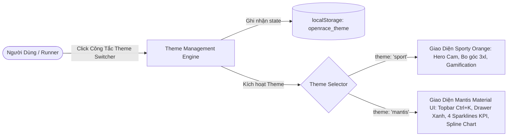
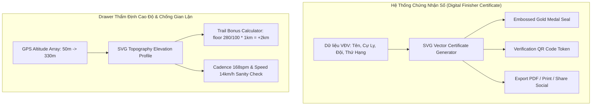
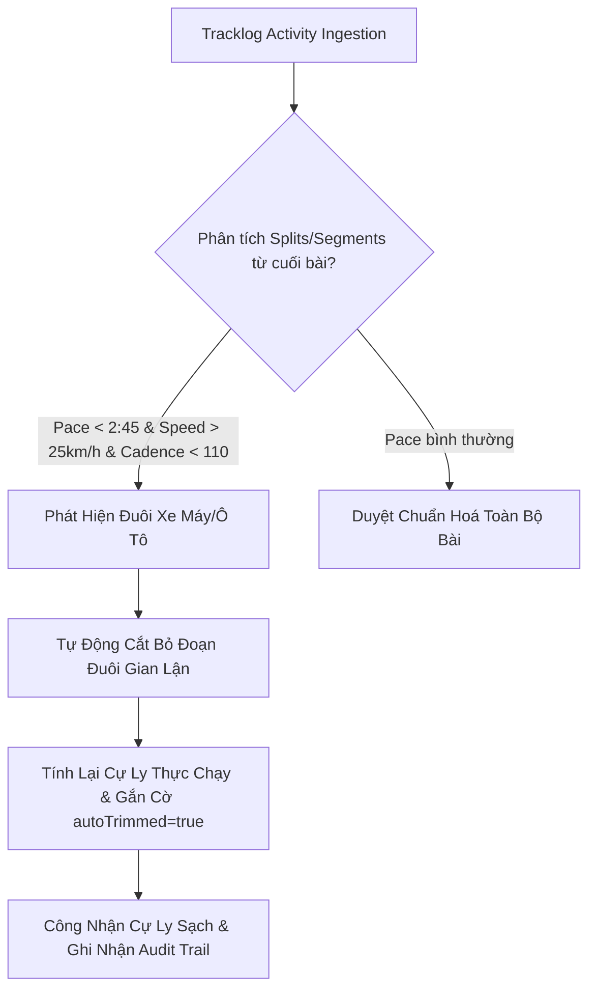
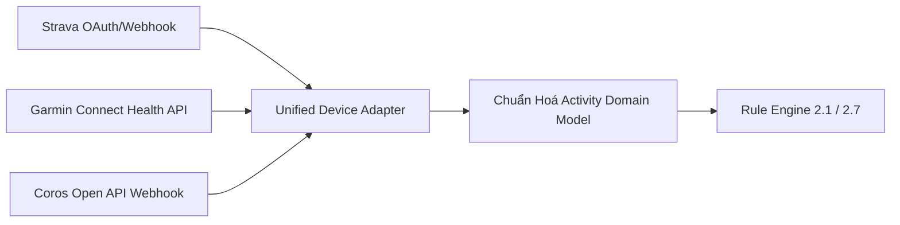
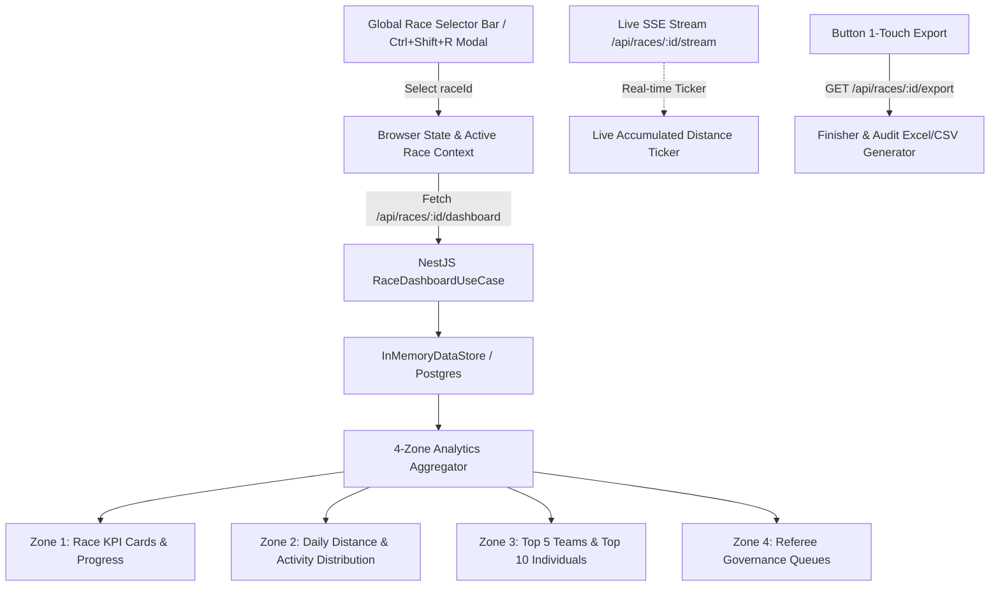
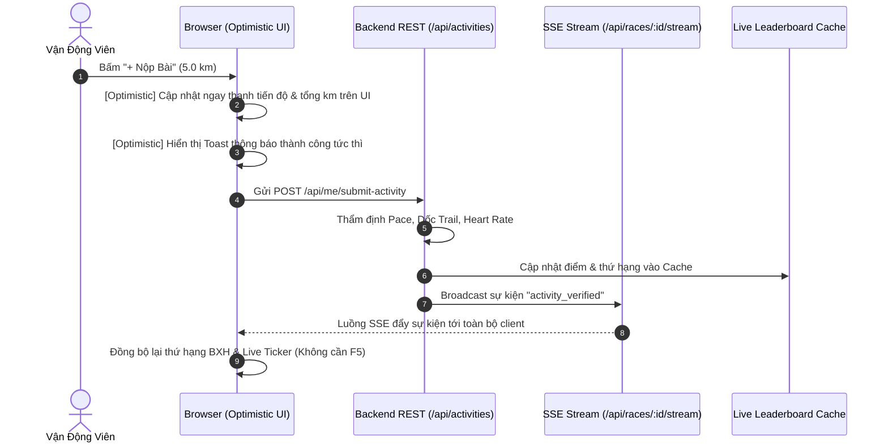

# SYSTEM ARCHITECTURE SPECIFICATION (V2.1 FULL PLATFORM)
## OpenRace SaaS Platform — Multi-Club Online Running Management, Social Athletics & Club ERP
**Version:** 2.1.0  
**Authority Reference:** `inputs/SRS2_1.md` (OR-SRS-SDS-2026-V2.1), `shared_context/PRD.md`  
**Stack Rule:** STRICT TYPESCRIPT (NestJS Hexagonal/Clean Architecture + Next.js 15 App Router + Supabase PostgreSQL 16 + Redis 7 + Jest) — NO PYTHON ALLOWED.  

---

### 1. Kiến Trúc Cặp 2 Màn Hình & Cây Điều Hướng V2.1 (Taxonomy)

Theo chuẩn đặc tả tại `inputs/SRS2_1.md` Mục 3 và Mục 4, hệ thống OpenRace SaaS v2.1 được chuẩn hóa thành 10 Cặp màn hình chức năng (20 màn hình lõi) bổ trợ lẫn nhau theo mô hình Master-Detail / List-Action:

```
========================================================================================
CÂY MENU ĐIỀU HƯỚNG TOÀN SÀN OPENRACE V2.1 (CHỈ DẪN URL ROUTING)
========================================================================================

[PHÂN HỆ NGƯỜI DÙNG & RUNNER]
├── [Cặp 1] Cá nhân & Đồng bộ Strava
│   ├── UI-01A: Dashboard Runner (Personal Hub) .......................... Path: /
│   └── UI-01B: Quản lý Kết nối & Nhật ký Strava Sync ................... Path: /me/strava-sync
├── [Cặp 2] Giải đấu & Đấu trường
│   ├── UI-02A: Khám phá & Danh sách Giải đấu ............................ Path: /races
│   └── UI-02B: Đấu trường Giải & Bảng xếp hạng Thời gian thực ........... Path: /r/{race_slug}
├── [Cặp 3] Nhật ký Hoạt động & Thẩm định
│   ├── UI-03A: Bảng tổng hợp Bài chạy Cá nhân ........................... Path: /activities
│   └── UI-03B: Chi tiết Thẩm định & Gửi Khiếu nại ....................... Path: /activities/{id}
├── [Cặp 4] Câu lạc bộ & Tiếp nhận lời mời
│   ├── UI-04A: Trang chủ Câu lạc bộ (Club Portal) ....................... Path: /c/{club_slug}
│   └── UI-04B: Cổng Tiếp nhận Lời mời & Onboarding Gia nhập ............. Path: /join/{invite_token}
├── [Cặp 5] Tài chính & Minh bạch Quỹ
│   ├── UI-05A: Sổ nợ & VietQR Nộp tiền Cá nhân .......................... Path: /r/{race_slug}/my-finance
│   └── UI-05B: Bảng Đối soát Quỹ Giải & Xác nhận Nộp tiền (Admin) ....... Path: /r/{race_slug}/finance/reconcile
├── [Cặp 7] Đội thi đấu (Không gian Đội)
│   ├── UI-07A: Danh bạ & Bảng phong độ Đội thi đấu ...................... Path: /r/{race_slug}/teams
│   └── UI-07B: Không gian Quản trị Đội của Đội trưởng .................. Path: /r/{race_slug}/teams/{id}/manage
├── [Cặp 8] Mạng xã hội Chạy bộ & Bạn bè
│   ├── UI-08A: Bảng tin Hoạt động Cộng đồng (Social Feed) ............... Path: /community/feed
│   └── UI-08B: Mạng lưới Bạn bè & Hồ sơ Vận động viên ................... Path: /community/friends
├── [Cặp 9] Tán gẫu, PacerBot AI & Banter
│   ├── UI-09A: Phòng Chat Thời gian thực (Kênh CLB & Đội) ............... Path: /chat
│   └── UI-09B: Trung tâm Điều khiển AI PacerBot & Banter Engine ........ Path: /clubs/{slug}/banter-settings

[PHÂN HỆ BAN QUẢN TRỊ CLB & SUPER ADMIN]
├── [Cặp 6] Điều hành Thể lệ Giải đấu
│   ├── UI-06A: Danh sách Quản trị Giải đấu CLB .......................... Path: /clubs/{slug}/races-manage
│   └── UI-06B: Wizard 7 bước Thiết lập Thể lệ & Dry-run ................. Path: /clubs/{slug}/races/wizard
└── [Cặp 10] Điều hành Toàn diện Câu lạc bộ (Club ERP)
    ├── UI-10A: Trung tâm Điều hành CLB (Tổng quan & Quản lý Thành viên) . Path: /clubs/{slug}/manage
    └── UI-10B: Quản trị Kỷ luật, Lịch Sự kiện & Kho Tri thức ........... Path: /clubs/{slug}/governance
========================================================================================
```

---

### 2. Thiết Kế Cơ Sở Dữ Liệu PostgreSQL 16 (Supabase)

Hệ thống quản lý dữ liệu đa người thuê (Multi-tenancy) cô lập theo `club_id` và áp dụng bảo mật hàng RLS:

#### Danh mục 18+ Bảng thực thể:
1. `users`: Tài khoản toàn cục, email, avatar, oauth_tokens, preferences.
2. `clubs`: Thực thể CLB độc lập, slug, logo, cover_url, bio, hotline.
3. `club_payment_accounts`: Cấu hình tài khoản ngân hàng thụ hưởng VietQR (Bank BIN, STK, Tên chủ TK).
4. `club_members`: Thành viên CLB, vai trò (`admin`, `captain`, `member`), trạng thái (`active`, `suspended`).
5. `races`: Giải đấu, slug, phạm vi (`internal`, `community`, `designated_whitelist`), trạng thái vòng đời.
6. `race_rules`: Tham số Rule Set dạng JSONB bất biến theo số hiệu phiên bản `version`.
7. `race_whitelists`: Danh sách email vận động viên được cấp quyền tham gia giải chỉ định.
8. `teams`: Đội thi đấu trong giải, tên đội, cờ hiệu avatar đội, đội trưởng `leader_id`, slogan.
9. `race_participants`: Ghi danh tham gia giải, gán đội `team_id`, đồng thuận kép (`consent_strava`, `consent_rules`).
10. `activities`: Bài chạy thô từ Strava (immutable), polyline, khoảng thời gian `start_at` -> `end_at`.
11. `activity_logs`: Bản ghi thẩm định của Activity trong 1 Race cụ thể, lưu mã lỗi `reject_code`, cự ly công nhận `final_distance_km`.
12. `appeals`: Đơn khiếu nại bài chạy lỗi, lý do, ảnh minh chứng, trạng thái (`OPEN`, `APPROVED`, `REJECTED`).
13. `ledger_entries`: Sổ cái tài chính bất biến, tiền quỹ theo bậc thứ hạng, tiền phạt tuần, thanh toán.
14. `penalty_waivers`: Quyết định miễn trừ phạt tuần do Admin phê duyệt kèm lý do.
15. `strava_sync_logs`: Nhật ký nhận gói tin webhook thô từ Strava, phục vụ tra cứu kỹ thuật.
16. `friendships`: Đồ thị bạn bè 2 chiều (`requester_id`, `addressee_id`, `status: PENDING | ACCEPTED`).
17. `kudos`: Lượt thả tim/khen ngợi hoạt động chạy bộ cộng đồng.
18. `comments`: Bình luận thảo luận dưới bài chạy cộng đồng.
19. `chat_messages`: Tin nhắn trong các phòng chat (CLB, Đội, Ban chủ nhiệm, bot messages).
20. `club_events`: Sự kiện sinh hoạt & buổi chạy Offline của CLB, lịch tập trung, file GPX, RSVP.
21. `club_polls` & `poll_votes`: Biểu quyết nội bộ CLB và phiếu bầu của thành viên.

---

### 3. Kiến Trúc Backend NestJS (Clean / Modular Architecture)

```
workspace/backend/src/
├── application/
│   ├── dtos/                    # DTOs with class-validator
│   └── use-cases/               # Use cases / Application services
│       ├── webhook-ingestion.use-case.ts
│       ├── rule-engine.use-case.ts
│       ├── scoring-leaderboard.use-case.ts
│       ├── cycle-penalty.use-case.ts
│       ├── finance-vietqr.use-case.ts
│       ├── team-management.use-case.ts
│       ├── community-social.use-case.ts
│       ├── chat-banter.use-case.ts
│       ├── club-governance.use-case.ts
│       └── admin-management.use-case.ts
├── domain/                      # Domain logic & pure calculations
│   ├── rule-engine/             # 6-step validation pipeline & 2:45 pace floor
│   ├── scoring/                 # 50/50 distance + diligence scoring
│   ├── cycle-penalty/           # Weekly cycle, 6h grace period, proration
│   └── finance/                 # VietQR generation (<= 25 chars) & ledger
└── infrastructure/
    ├── controllers/             # RESTful API controllers
    ├── gateways/                # WebSockets & SSE live stream gateways
    ├── repositories/            # Data stores & PostgreSQL / Supabase client
    └── workers/                 # Background queue processors (BullMQ)
```

---

### 4. Kiến Trúc Frontend Next.js 15 (App Router Structure)

```
workspace/frontend/src/app/
├── (auth)/
│   └── login/page.tsx           # Authentication with Google/Apple & Strava OAuth
├── (runner)/
│   ├── page.tsx                 # [UI-01A] Dashboard Runner Hub
│   ├── me/
│   │   └── strava-sync/page.tsx # [UI-01B] Strava Sync Logs & Connection Control
│   ├── races/
│   │   ├── page.tsx             # [UI-02A] Explore Races Directory
│   │   └── [slug]/
│   │       ├── page.tsx         # [UI-02B] Race Arena & Live SSE Leaderboard
│   │       ├── my-finance/page.tsx # [UI-05A] Personal Debt & VietQR Pay
│   │       └── teams/
│   │           ├── page.tsx     # [UI-07A] Team Directory & Standings
│   │           └── [id]/manage/page.tsx # [UI-07B] Captain Team Portal
│   ├── activities/
│   │   ├── page.tsx             # [UI-03A] Activity Feed
│   │   └── [id]/page.tsx        # [UI-03B] Audit Pipeline & Appeal Drawer
│   ├── c/[slug]/page.tsx        # [UI-04A] Club Portal
│   ├── join/[token]/page.tsx    # [UI-04B] In-App Detour & Onboarding
│   ├── community/
│   │   ├── feed/page.tsx        # [UI-08A] Social Feed & Kudos
│   │   └── friends/page.tsx     # [UI-08B] Friends Graph & Runner Profile
│   └── chat/page.tsx            # [UI-09A] WebSockets Real-time Chat
└── (admin)/
    ├── clubs/[slug]/
    │   ├── races-manage/page.tsx   # [UI-06A] Club Race Management
    │   ├── races/wizard/page.tsx   # [UI-06B] 7-Step Rule Configurator Wizard
    │   ├── banter-settings/page.tsx # [UI-09B] AI PacerBot & Banter Controls
    │   ├── manage/page.tsx         # [UI-10A] Club Central & Members
    │   └── governance/page.tsx     # [UI-10B] Disciplinary, Events & Polls
    ├── r/[slug]/finance/reconcile/page.tsx # [UI-05B] Admin Reconcile
    └── admin/page.tsx           # Super Admin Portal (Quota, DLQ, Recompute)
```

---

### 5. Đặc Tả Thuật Toán & Quy Tắc Toán Học (Rule Engine 2.1)

1. **Khóa Sàn Pace Tuyệt Đối:**
   $$\text{Pace} < 2:45\text{ min/km} \implies \text{reject\_code} = \text{PACE\_IMPLAUSIBLE}$$
2. **Thưởng Dốc Trail Địa Hình:**
   $$\text{Bonus km} = \min\left(\left\lfloor \frac{\text{elevation\_gain\_m}}{100} \right\rfloor \times 1.0, \; \text{max\_bonus\_km\_per\_activity}\right)$$
   $$\text{Final Distance} = \text{Raw Distance} + \text{Bonus km}$$
3. **Chấm Điểm Đội 50/50:**
   $$\text{Score}_{\text{Team}} = 10 \times \frac{\text{Distance}_{\text{Team}}}{\max(\text{Distance})} + 10 \times \frac{\min(\text{Days}_{\text{Team}}, 140)}{140}$$
4. **Mã Tham Chiếu VietQR Chuẩn Hóa:**
   $$\text{Ref Code} = \text{Uppercase}(\text{RaceCode} + \text{"-"} + \text{ShortToken}) \quad (\text{Chiều dài} \le 25\text{ ký tự})$$

---

### 6. Kiến Trúc Bộ Đổi Giao Diện Đa Phong Cách (Dual-Theme & Mantis Material UI Architecture)

Nhằm đáp ứng yêu cầu người dùng lựa chọn giữa giao diện **OpenRace Sport (Cam Thể Thao)** và **Mantis Material UI (Doanh Nghiệp Xanh Dương)**:



#### 6.1. Thiết Kế Hệ Thống Design Tokens Cho Mantis Material UI:
- **Brand Colors:**
  * Primary: `#1890ff` (Mantis Blue), Hover: `#40a9ff`, Active: `#096dd9`, Tint: `#e6f7ff`
  * Accent Red: `#ff4d4f` (Area Sparkline)
  * Accent Yellow: `#faad14` (Bar Sparkline)
  * Accent Green: `#52c41a` (Success Badges)
- **Surfaces & Borders:**
  * App Background Canvas: `#f4f6f8` / `#fafafb`
  * Elevated Card Background: `#ffffff`
  * Sub-borders & Dividers: `#f0f0f0` / `#e8e8e8`
  * Border Radius: `rounded-lg` (8px) và `rounded-xl` (12px)
  * Box Shadow: `0 2px 8px rgba(0, 0, 0, 0.05)`

#### 6.2. Cấu Trúc Component Mantis Material UI:
1. **Mantis Top App Bar (`#mantis-header`):**
   - Brand Logo Mantis hình lục giác kim cương xanh + chữ Mantis
   - Menu drawer toggle (Hamburger)
   - Thanh tìm kiếm Global Search với phím tắt bàn phím badge `Ctrl + K`
   - Nhóm icon tiện ích: Ngôn ngữ, Chuyển Theme Switcher, Chuông thông báo (badge đỏ số 2), Hồ sơ tài khoản "JWT User"
2. **Mantis Navigation Drawer (`#mantis-sidebar`):**
   - Phân cấp danh mục rõ ràng: Dashboard (Default, Analytics - active viền mép phải `#1890ff`), Components, Widgets (Statistics, Data, Chart), Applications (Chat, Calendar, Kanban, Profile), Forms & Tables
   - Thẻ người dùng chân trang với avatar và chức danh
3. **Mantis Analytics Dashboard Canvas (`#mantis-dashboard-view`):**
   - **Hero Welcome Card:** Nền gradient xanh dương (`bg-gradient-to-r from-blue-600 via-blue-500 to-sky-400`), tiêu đề "Welcome to Mantis / OpenRace Analytics", nút `[View Full Statistic]`
   - **4 KPI Metric Cards với Sparklines SVG tích hợp:**
     * Thẻ 1: Tổng Vận Động Viên (Bar Chart mini xanh)
     * Thẻ 2: Tổng Cự Ly Giải (Area Gradient mini đỏ/san hô)
     * Thẻ 3: Quỹ Thi Đấu (Bar Chart mini vàng)
     * Thẻ 4: Tỷ Lệ Hoàn Thành (Spline Line mini xanh)
   - **Main Analytics Grid:**
     * Cột trái: "Income Overview / Tổng Quan Hoạt Động" với bộ lọc Tuần/Tháng, biểu đồ Spline Area Chart mượt mà
     * Cột phải: "Page Views / Top Bảng Xếp Hạng & Lưu Lượng" với danh sách tỷ lệ % đóng góp
4. **Theme Switcher Component (`#theme-mode-switcher`):**
   - Nút gạt chọn chế độ đặt tại Header và Menu Cài đặt: `[ ⚡ Thể Thao Cam ]` vs `[ 💎 Mantis Material UI ]`
   - Hàm `switchAppTheme(theme)` cập nhật DOM, ẩn/hiện header và layout container tương ứng, lưu `openrace_theme` vào `localStorage`.

---

### 7. Thiết Kế Hệ Thống Chứng Nhận Số & Thẩm Định Cao Độ Dốc GPS (Finisher Certificate & Elevation Audit)



#### 7.1. Cấu Trúc Component Chứng Nhận Số (`#modal-finisher-certificate`):
- Khung viền mạ vàng kép (Double Gold Foil Border) sang trọng.
- Tiêu đề song ngữ: "CHỨNG NHẬN HOÀN THÀNH / CERTIFICATE OF COMPLETION".
- Dữ liệu hiển thị động: Tên VĐV, Cự ly hoàn thành ($1,250.0\text{ km}$), Số ngày chuyên cần ($118/140$ ngày), Thứ hạng Vô Địch Đồng Đội (Top 1 Phoenix SARC).
- Con dấu nổi mạ vàng dập nổi chính thức của Ban Điều Hành SARC và mã QR xác thực danh tính số độc nhất.
- Nút in chứng nhận và chia sẻ lên mạng xã hội.

#### 7.2. Cấu Trúc Component Thẩm Định Cao Độ Trắc Địa (`#drawer-elevation-audit`):
- Biểu đồ trắc địa liên tục (Topography Polygon) minh họa cao độ dọc theo quãng đường chạy từ $0\text{km} \rightarrow 8\text{km}$.
- Bảng phân rã 3 bước tính thưởng Trail Elevation Gain:
  $$\text{Gain Thô: } 280\text{m} \implies \lfloor 280 / 100 \rfloor = 2 \implies \text{Bonus: } +2.0\text{km}$$
- Bộ chỉ số chống gian lận (Anti-Cheat Sanity Metrics):
  * Nhịp bước trung bình (Cadence): $168\text{ spm}$ (Xác nhận vận động viên chạy thật, không phải đi xe).
  * Tốc độ tối đa (Max Speed): $14.2\text{ km/h}$ (Hợp lệ, không vi phạm sàn pace $2:45\text{ min/km}$).

---

### 8. THIẾT KẾ KIẾN TRÚC 3 TÍNH NĂNG MỞ RỘNG THỰC CHIẾN (v2.7.0)

#### 8.1. Thuật Toán Tự Động Cắt Đuôi Phương Tiện (Auto-Trim Vehicle Tail Algorithm)


- **Nguyên lý:** Phân tích lùi từ split cuối cùng (Reverse Sliding Window). Nếu phát hiện điểm rơi nhịp bước ($\text{Cadence} < 110\text{ spm}$) đồng thời vận tốc nhảy vọt ($> 25\text{ km/h}$, $\text{Pace} < 2:45$) trong khi $\ge 85\%$ phần thân bài chạy đạt chuẩn sinh học người chạy:
- Tự động cắt bỏ phân đoạn đuôi, lưu vết `originalDistanceKm`, `trimmedDistanceKm`, `creditedDistanceKm` và gán nhãn `AUTO_TRIMMED_VEHICLE_TAIL`.

#### 8.2. Hệ Sinh Thái Kết Nối Thiết Bị Đeo Đa Nền Tảng (Multi-Vendor Device Gateway)

- Quản lý trạng thái độc lập qua bảng `ConnectedDevices` (hỗ trợ bật/tắt từng nền tảng, theo dõi `lastSyncAt`).
- Cung cấp API `GET /api/me/connected-devices`, `POST /api/me/devices/connect`, `POST /api/me/devices/disconnect`, và các cổng webhook trực tiếp (`/api/webhooks/garmin`, `/api/webhooks/coros`).

#### 8.3. Động Cơ Thẩm Định Máy Chạy Bộ Trong Nhà (Treadmill Biometric Engine)
- Bổ sung trường dữ liệu sinh trắc học: `avgHeartRate` (Nhịp tim trung bình) và `avgCadence` (Nhịp bước).
- **Bộ lọc kiểm chứng kép (Dual Verification Filter):**
  1. Kiểm tra nhịp tim: $\text{avgHeartRate} \ge 120\text{ bpm}$ (loại trừ trường hợp cầm đồng hồ lắc tay hoặc ngồi ghế rung).
  2. Kiểm tra sải bước: $\text{avgCadence} \ge 150\text{ spm}$ (chứng minh sải chân đều đặn trên băng tải máy chạy).
  3. Cự ly tối thiểu $\ge 3.0\text{ km}$ và Pace nằm trong biên độ cho phép $4:00 - 10:00\text{ min/km}$.
- Khi thỏa mãn, hệ thống cấp cờ `isTreadmillVerified = true` và tính điểm hợp lệ $100\%$ vào giải đấu.

---

### 11. THIẾT KẾ KIẾN TRÚC DASHBOARD GIẢI ĐẤU ĐA LỰA CHỌN (MULTI-SELECTION RACE DASHBOARD v3.5.0)

#### 11.1. Sơ Đồ Kiến Trúc Luồng Dữ Liệu & Dynamic Re-fetch


#### 11.2. 4 Khu Vực Thông Tin Trọng Tâm (4 Central Information Zones)
1. **Zone 1: Thẻ Chỉ Số Tổng Quan Giải Đấu (Race KPI Cards)**
   - Tổng VĐV tham gia (phân rã theo CLB & Đội đua nội bộ).
   - Tổng cự ly tích lũy (Total KM) so với mục tiêu mùa giải (thanh tiến độ thực thi $\text{e.g. } 15,420 / 20,000\text{ KM}$).
   - Tỷ lệ hoàn thành trung bình (Completion Rate %).
   - Quỹ giải thưởng / Sổ nợ quỹ phát sinh minh bạch.

2. **Zone 2: Biểu Đồ Diễn Biến & Tốc Độ Tăng Trưởng (Race Analytics & Trend)**
   - Biểu đồ cự ly theo ngày (Daily Distance Bar Chart) hiển thị các ngày cao điểm (Cuối tuần Long Run).
   - Biểu đồ phân bổ Pace & Loại hình (Activity Distribution: Road %, Trail %, Treadmill %) phục vụ công tác kiểm định của Trọng tài.

3. **Zone 3: Bảng Xếp Hạng & Đội Đua Dẫn Đầu (Live Race Leaderboard Preview)**
   - Top 5 Đội Đua Nội Bộ dẫn đầu kèm cúp vàng 🥇, bạc 🥈, đồng 🥉 và cự ly tích lũy.
   - Top 10 Cá Nhân bứt phá (Highest Mileage Breakout Runners).

4. **Zone 4: Hàng Đợi Kiểm Định & Báo Cáo Vi Phạm (Race Governance & Violation Queues)**
   - Bảng theo dõi các bài chạy nghi vấn (tốc độ xe máy, dốc trail bất thường) chờ Trọng tài xử lý riêng cho giải đấu.

#### 11.3. Quy Trình Thao Tác Tối Ưu (Optimal UX Workflow)
- **Phím tắt nhanh:** `Ctrl + Shift + R` mở ngay modal tìm kiếm và chọn giải đấu mọi lúc mọi nơi.
- **SSE Live Ticker:** Cập nhật nảy số cự ly thời gian thực từng giây theo diễn biến giải đấu.
- **Xuất Báo Cáo 1 Chạm:** Nút `[📥 Xuất Báo Cáo Tổng Kết Giải]` tải ngay file CSV/Excel tổng hợp danh sách Finisher, xếp hạng và nhật ký kiểm định.

---

### 12. KIẾN TRÚC TỐI ƯU HÓA TRẢI NGHIỆM SAAS (v3.0.0-PROD)

#### 12.1. Tái Cấu Trúc & Rút Gọn Menu Bên Trái (Concise SaaS Navigation)
Loại bỏ hoàn toàn các huy hiệu (badges) động gây phân tâm thị giác, chuẩn hóa tên gọi 19 menu theo chuẩn SaaS súc tích:

1. **Phân Hệ Vận Động Viên (Runner Portal):**
   - `Tổng Quan` (Dashboard cá nhân & tiến độ tuần)
   - `Nhật Ký & Bài Chạy` (Activities & log thẩm định)
   - `Bảng Xếp Hạng` (Đấu trường & BXH)
   - `Kết Nối Thiết Bị` (Strava, Garmin, Coros)
   - `Quỹ & Sổ Nợ` (Dynamic VietQR & sổ phạt)

2. **Phân Hệ Câu Lạc Bộ & Đội (Club & Team Space):**
   - `Câu Lạc Bộ` (Không gian CLB & thông tin ban cán sự)
   - `Đội Của Tôi` (Đội đua nội bộ Team Phoenix)
   - `Bảng Tin & Kudos` (Mạng xã hội nội bộ, thả Kudos)
   - `Trợ Lý AI` (PacerBot 24/7 cố vấn thể lực)
   - `Hoạt Động & Biểu Quyết` (Điểm danh sự kiện & biểu quyết)

3. **Phân Hệ Ban Điều Hành CLB (Club Admin Portal):**
   - `Thành Viên` (Quản trị sĩ số & mã mời)
   - `Thiết Lập Giải` (Điều hành giải & quy chế)
   - `Kiểm Duyệt Bài` (Duyệt hàng loạt bài chạy & khiếu nại)
   - `Tài Chính & Quỹ` (Đối soát tài chính & VietQR BIN)
   - `Truyền Thông & Chốt Tuần` (Broadcast thông báo & chốt sổ tuần)

4. **Phân Hệ Quản Trị Nền Tảng (Super Admin Portal):**
   - `Giám Sát Hệ Thống` (Hạ tầng, Strava Quota & Webhook queue)
   - `Quản Lý Tenant` (Đa thuê bao CLB SaaS)
   - `Phân Quyền (RBAC)` (IAM & ma trận quyền)
   - `Tham Số Hệ Thống` (4 bộ danh mục thiết lập chung)

#### 12.2. Thanh Thao Tác Di Động (Mobile Sticky Bottom Action Bar)
Thiết kế tối ưu ngón cái (Thumb-friendly Navigation) tại vị trí chân màn hình di động:
- `[⚡ Đồng Bộ]`: Kích hoạt `triggerOptimisticStravaSync()`
- `[➕ Nộp Bài]`: Mở modal `openAddActivityModal()` kèm thẩm định tự động
- `[💳 Sổ Nợ QR]`: Mở modal `openDynamicVietQrModal()` thanh toán tức thì
- `[🤖 PacerBot]`: Chuyển nhanh sang tab trò chuyện cùng AI Coach
- `[⚙️ Tùy Biến]`: Mở drawer cấu hình widget Dashboard

#### 12.3. Mô Hình Optimistic UI & Real-Time SSE



